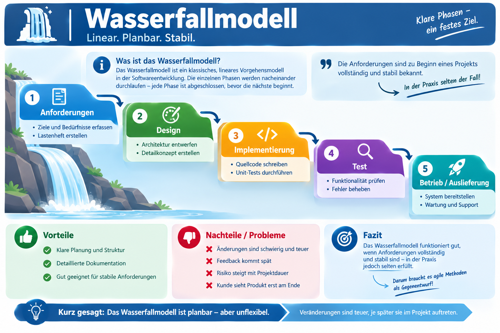
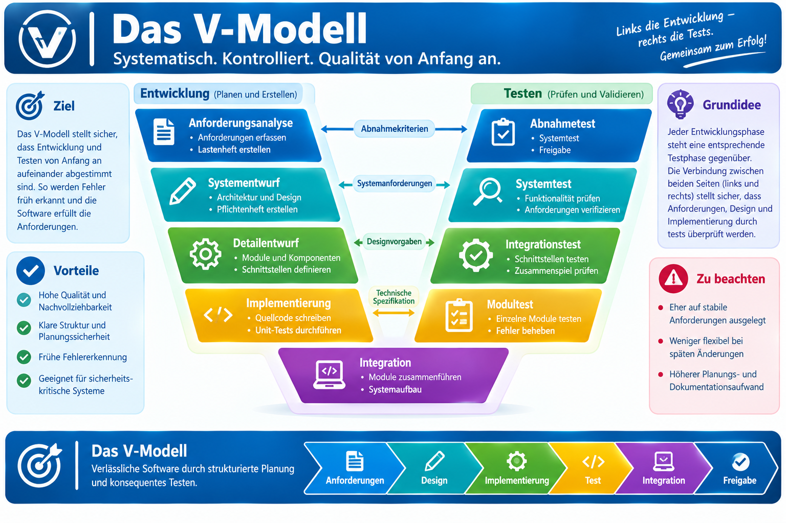

|                      |                           |                               |
| -------------------- | ------------------------- | ----------------------------- |
| **HF Systemtechnik** | **Softwareentwicklung A** |  |

- [1. Der Softwareentwicklungsprozess](#1-der-softwareentwicklungsprozess)
  - [1.1. Lernziele](#11-lernziele)
  - [1.2. Kern- und Unterstützungsprozesse](#12-kern--und-unterstützungsprozesse)
  - [1.3. Das klassische Phasenmodell (Wasserfallmodell)](#13-das-klassische-phasenmodell-wasserfallmodell)
  - [1.4. Das V-Modell – Test als gleichwertige Disziplin](#14-das-v-modell--test-als-gleichwertige-disziplin)
  - [1.5. Warum frühes Erkennen von Fehlern entscheidend ist](#15-warum-frühes-erkennen-von-fehlern-entscheidend-ist)
  - [1.6. Anwendung auf ein Systemtechnik-Szenario](#16-anwendung-auf-ein-systemtechnik-szenario)
- [2. Übungsaufgaben](#2-übungsaufgaben)
  - [2.1. Prozesse zuordnen](#21-prozesse-zuordnen)
  - [2.2. Phasenmodell und Fehlerkosten anwenden](#22-phasenmodell-und-fehlerkosten-anwenden)

---

# 1. Der Softwareentwicklungsprozess

## 1.1. Lernziele

Nach diesem Kapitel können Sie:

- [ ] Kern- und Unterstützungsprozesse der Softwareentwicklung benennen und voneinander abgrenzen
- [ ] das klassische Phasenmodell (Wasserfallmodell) mit seinen Phasen erklären
- [ ] das V-Modell als Erweiterung des Wasserfallmodells beschreiben
- [ ] erklären, weshalb Fehler umso teurer sind, je später sie im Prozess entdeckt werden
- [ ] den Gesamtprozess auf ein eigenes Praxisbeispiel übertragen

---

## 1.2. Kern- und Unterstützungsprozesse

Der Gesamtprozess der Softwareentwicklung lässt sich in zwei Kategorien gliedern:

| **Prozessart**             | **Beispiele**                                                                  | **Zweck**                                   |
| -------------------------- | ------------------------------------------------------------------------------ | ------------------------------------------- |
| **Kernprozesse**           | Anforderungsanalyse, Entwurf, Implementierung, Test, Abnahme, Betrieb/Wartung  | Erzeugen direkt das Softwareprodukt         |
| **Unterstützungsprozesse** | Projektmanagement, Konfigurationsmanagement, Dokumentation, Qualitätssicherung | Ermöglichen und sichern die Kernprozesse ab |

Die Unterstützungsprozesse werden im Berufsalltag häufig unterschätzt, da sie kein direkt sichtbares "Produkt" erzeugen. Fehlt aber z.B. das Konfigurationsmanagement (Versionsverwaltung), verliert ein Team schnell den Überblick, welche Codeversion aktuell im Einsatz ist – mit entsprechenden Folgefehlern.

> **Praxisbeispiel:** Auch ein Ein-Personen-Projekt (z.B. ein eigenes PowerShell-Tool) profitiert von Unterstützungsprozessen: Eine einfache Versionsverwaltung (z.B. Git) oder ein Änderungsprotokoll verhindert, dass man nach Monaten nicht mehr weiss, warum eine bestimmte Codezeile geändert wurde.

---

## 1.3. Das klassische Phasenmodell (Wasserfallmodell)

Das Wasserfallmodell ist das älteste und einfachste Vorgehensmodell der Softwareentwicklung: Die Phasen laufen **linear und sequenziell** ab – erst wenn eine Phase abgeschlossen ist, beginnt die nächste.

| **Phase**               | **Zentrale Frage**                                   | **Typisches Ergebnis (Dokument/Artefakt)**          |
| ----------------------- | ---------------------------------------------------- | --------------------------------------------------- |
| **Anforderungsanalyse** | Was soll die Software leisten?                       | Spezifikation / Pflichtenheft (→ Kapitel 3)         |
| **Entwurf**             | Wie ist die Lösung strukturiert?                     | Zustandsdiagramm, Struktogramm, PAP (→ Kapitel 4–6) |
| **Implementierung**     | Wie wird es konkret umgesetzt?                       | Quellcode                                           |
| **Test**                | Funktioniert es wie gefordert?                       | Testprotokoll, Fehlerliste                          |
| **Einführung/Betrieb**  | Wie gelangt die Software in den produktiven Einsatz? | Installationsanleitung, Schulung                    |
| **Wartung**             | Läuft es stabil, wie werden Änderungen gehandhabt?   | Changelog, Fehlerkorrekturen, neue Versionen        |

**Vorteile:** Klar strukturiert, gut planbar, einfach zu verstehen und zu kommunizieren – besonders geeignet, wenn Anforderungen zu Beginn bereits stabil und vollständig bekannt sind.

**Nachteile:** Änderungen der Anforderungen während des Projekts sind teuer, da man formal in eine frühere Phase zurückkehren müsste. Der Auftraggeber sieht ein lauffähiges Ergebnis oft erst sehr spät im Projekt.

> **Wichtig:** Dieses Modul zeigt das Wasserfallmodell als **gedankliches Grundgerüst**, um die Kernphasen sauber zu verstehen. In Kapitel 9 wird gezeigt, dass reale Projekte selten streng linear ablaufen (→ Agile Entwicklung).

---

## 1.4. Das V-Modell – Test als gleichwertige Disziplin

Eine bekannte Erweiterung des Wasserfallmodells ist das **V-Modell**. Es stellt den Entwicklungsprozessen auf der linken Seite die passenden Testaktivitäten auf der rechten Seite gegenüber – jede Entwurfsphase erhält damit eine "spiegelbildliche" Prüfphase.

> **Kernidee:** Für jede Entwurfsebene wird bereits **während des Entwurfs** festgelegt, wie später getestet wird. Ein Abnahmetest wird z. B. direkt aus den Anforderungen abgeleitet – nicht erst am Ende improvisiert.

---

## 1.5. Warum frühes Erkennen von Fehlern entscheidend ist

Ein zentraler Grundsatz der Softwareentwicklung lautet: **Je später ein Fehler entdeckt wird, desto teurer ist seine Behebung.**

| **Phase der Entdeckung** | **Relativer Korrekturaufwand (Grössenordnung)** |
| ------------------------ | ----------------------------------------------- |
| Anforderungsanalyse      | Sehr gering (1×)                                |
| Entwurf                  | Gering (mehrfach)                               |
| Implementierung          | Mittel                                          |
| Test                     | Hoch                                            |
| Betrieb (beim Kunden)    | Sehr hoch (Vielfaches)                          |

**Erklärung:** Ein Fehler in der Anforderung, der erst im Betrieb entdeckt wird, betrifft meist nicht nur eine einzelne Codezeile, sondern den gesamten darauf aufbauenden Entwurf, die Implementierung, die Tests und ggf. bereits ausgelieferte Dokumentation – all das muss angepasst werden.

> **Genau deshalb** ist der Aufwand für Spezifikation, Zustandsdiagramm, Struktogramm und PAP (Kapitel 3–6) gut investierte Zeit: Fehler und Missverständnisse werden auf dem Papier sichtbar, **bevor** eine einzige Codezeile geschrieben wurde.

---

## 1.6. Anwendung auf ein Systemtechnik-Szenario

Angenommen, es soll eine kleine Anwendung entstehen, die den Energieverbrauch einer Werkhalle pro Woche aus einer CSV-Datei zusammenfasst:

| **Phase**           | **Konkreter Schritt im Beispiel**                                              |
| ------------------- | ------------------------------------------------------------------------------ |
| Anforderungsanalyse | Klärung: Welches Dateiformat? Welche Kennzahlen? Wer nutzt den Bericht?        |
| Entwurf             | Ablauflogik festlegen: Was passiert, wenn die Datei fehlt oder fehlerhaft ist? |
| Implementierung     | Umsetzung z. B. in C# oder als PowerShell-Skript                               |
| Test                | Funktioniert es auch mit leerer Datei, mit falschem Format, mit Sonderzeichen? |
| Betrieb/Wartung     | Wer pflegt das Tool, wenn sich das Dateiformat des Messsystems ändert?         |

---

 

# 2. Übungsaufgaben

## 2.1. Prozesse zuordnen

| **Vorgabe**         | **Beschreibung**                                      |
| :------------------ | :---------------------------------------------------- |
| **Lernziele**       | Kern- und Unterstützungsprozesse unterscheiden können |
| **Sozialform**      | Einzelarbeit                                          |
| **Auftrag**         | siehe unten                                           |
| **Zeitbedarf**      | 20 min                                                |
| **Lösungselemente** | Tabellarische Zuordnung mit Begründung                |

**Aufgabenstellung:**

- Wählen Sie ein Softwareprodukt aus Ihrem Berufsalltag (App, Tool, Auswertesoftware – ohne SPS-Detail).
- Ordnen Sie mindestens 4 Tätigkeiten, die bei dessen Entstehung oder laufendem Betrieb nötig sind bzw. waren, den **Kern-** bzw. **Unterstützungsprozessen** (Kapitel 1.2) zu und begründen Sie Ihre Zuordnung in 2–3 Sätzen je Tätigkeit.

---

## 2.2. Phasenmodell und Fehlerkosten anwenden

| **Vorgabe**         | **Beschreibung**                                                                 |
| :------------------ | :------------------------------------------------------------------------------- |
| **Lernziele**       | Phasenmodell auf ein konkretes Beispiel anwenden; Fehlerkosten-Prinzip begründen |
| **Sozialform**      | Partnerarbeit                                                                    |
| **Auftrag**         | siehe unten                                                                      |
| **Zeitbedarf**      | 30 min                                                                           |
| **Lösungselemente** | Ausgefüllte Phasentabelle + schriftliche Begründung                              |

**Aufgabenstellung:**

Stellen Sie sich vor, Sie entwickeln eine kleine Anwendung, die den Energieverbrauch einer Werkhalle pro Woche zusammenfasst und als Bericht ausgibt (siehe Kapitel 2.5).

1. Formulieren Sie für jede der 6 Phasen des Wasserfallmodells mindestens einen konkreten Arbeitsschritt für dieses Beispiel.
2. Nehmen Sie an, ein wichtiges Kennzahlen-Kriterium wurde in der Anforderungsanalyse übersehen und erst beim produktiven Betrieb bemerkt. Begründen Sie anhand von Kapitel 2.4, weshalb die Korrektur an dieser Stelle besonders aufwändig ist.
3. Diskutieren Sie: Welche Phase würde in der Praxis am ehesten übersprungen oder verkürzt – und mit welchem Risiko?

---

© 2026 Lukas Müller – Licensed under CC BY-NC-ND 4.0
See [LICENSE](..\license.md) file for details.
