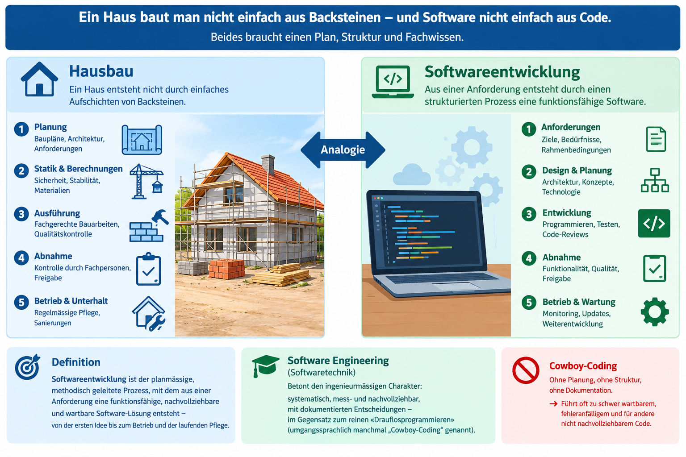
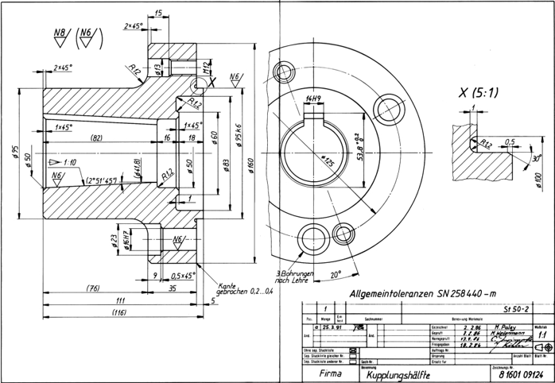

|                      |                           |                               |
| -------------------- | ------------------------- | ----------------------------- |
| **HF Systemtechnik** | **Softwareentwicklung A** |  |

- [1. Einführung in die Softwareentwicklung](#1-einführung-in-die-softwareentwicklung)
  - [1.1. Lernziele](#11-lernziele)
  - [1.2. Warum überhaupt "Softwareentwicklung"?](#12-warum-überhaupt-softwareentwicklung)
    - [1.2.1. Programmieren vs. Softwareentwicklung](#121-programmieren-vs-softwareentwicklung)
  - [1.3. Warum benötigen wir Modelle in der Softwareentwicklung?](#13-warum-benötigen-wir-modelle-in-der-softwareentwicklung)
  - [1.4. Was ist UML?](#14-was-ist-uml)
  - [1.5. Ein Plan beschreibt ein System](#15-ein-plan-beschreibt-ein-system)
  - [1.6. UML in der Praxis](#16-uml-in-der-praxis)
  - [1.7. Eigenschaften von Software](#17-eigenschaften-von-software)
  - [1.8. Warum scheitern Softwareprojekte?](#18-warum-scheitern-softwareprojekte)
    - [1.8.1. Gescheiterte Softwareprojekte](#181-gescheiterte-softwareprojekte)
  - [1.9. Die Rolle des Systemtechnikers/der Systemtechnikerin HF](#19-die-rolle-des-systemtechnikersder-systemtechnikerin-hf)
- [2. Übungsaufgaben](#2-übungsaufgaben)
  - [2.1. UML-Diagrammtypen](#21-uml-diagrammtypen)
  - [2.2. Softwareentwicklung vs. Programmieren](#22-softwareentwicklung-vs-programmieren)
  - [2.3. Ursachenanalyse aus der eigenen Praxis](#23-ursachenanalyse-aus-der-eigenen-praxis)
  - [2.4. Reale Fallbeispiele analysieren](#24-reale-fallbeispiele-analysieren)

---

 

# 1. Einführung in die Softwareentwicklung

## 1.1. Lernziele

Nach diesem Kapitel können Sie:

- [ ] Softwareentwicklung als planmässigen Entwicklungsprozess definieren und von reinem "Programmieren" abgrenzen
- [ ] typische Eigenschaften von Software (im Vergleich zu physischen Produkten) benennen
- [ ] die häufigsten Ursachen für gescheiterte oder verzögerte Softwareprojekte erklären
- [ ] die eigene Rolle als Systemtechniker/-in HF im Softwareentwicklungsumfeld einordnen

---

## 1.2. Warum überhaupt "Softwareentwicklung"?

Systemtechniker/-innen HF kommen im Berufsalltag laufend mit Software in Berührung: Auswertetools, kleine Automatisierungsskripte, Konfigurationswerkzeuge, Schnittstellenprogramme. Oft entsteht dabei der Eindruck, Programmieren bestehe einfach aus "Code schreiben, bis es läuft". In der Praxis zeigt sich aber rasch: Ohne systematisches Vorgehen wird selbst ein kleines Programm schwer wartbar, fehleranfällig und für andere Personen nicht nachvollziehbar.

> **Analogie:** Ein Haus baut man nicht, indem man einfach Backsteine aufeinanderschichtet, bis es "irgendwie" steht. Es braucht einen Plan, eine Statik, eine Abnahme durch Fachpersonen. Genauso braucht Software einen strukturierten Entstehungsprozess – auch wenn das Endprodukt "nur" ein PowerShell-Skript oder ein kleines Steuerprogramm ist.

**Definition:** Softwareentwicklung ist der planmässige, methodisch geleitete Prozess, mit dem aus einer Anforderung eine funktionsfähige, nachvollziehbare und wartbare Software-Lösung entsteht – von der ersten Idee bis zum Betrieb und der laufenden Pflege.

Der Begriff **Software Engineering** (Softwaretechnik) betont dabei zusätzlich den ingenieurmässigen Charakter: systematisch, mess- und nachvollziehbar, mit dokumentierten Entscheidungen – im Gegensatz zum reinen "Drauflosprogrammieren" (umgangssprachlich manchmal "Cowboy-Coding" genannt).

### 1.2.1. Programmieren vs. Softwareentwicklung

|                    | **Programmieren**         | **Softwareentwicklung**           |
| ------------------ | ------------------------- | --------------------------------- |
| Fokus              | Code schreiben            | Gesamter Entstehungsprozess       |
| Zeithorizont       | Aufgabe lösen             | Produkt über Lebensdauer betreuen |
| Dokumentation      | Oft implizit/fehlend      | Bewusster Bestandteil             |
| Qualitätssicherung | Ad hoc                    | Geplant (Reviews, Tests)          |
| Team-Fähigkeit     | Schwierig nachvollziehbar | Nachvollziehbar durch Struktur    |

Beide Tätigkeiten gehören zusammen – Programmieren ist eine (wichtige!) Teiltätigkeit **innerhalb** der Softwareentwicklung, nicht deren Synonym.

---

## 1.3. Warum benötigen wir Modelle in der Softwareentwicklung?

In der Softwareentwicklung entstehen häufig komplexe Systeme, die aus zahlreichen Komponenten, Datenstrukturen, Funktionen und Abhängigkeiten bestehen. Je grösser ein System wird, desto schwieriger ist es, alle Zusammenhänge gleichzeitig zu überblicken.

Ein Softwareentwickler muss beispielsweise verstehen:

- Welche Aufgaben soll das System erfüllen?
- Aus welchen Komponenten besteht das System?
- Wie sind diese Komponenten miteinander verbunden?
- Welche Daten werden verarbeitet?
- Wie kommunizieren die einzelnen Bestandteile miteinander?
- Welche Abläufe finden innerhalb des Systems statt?

Ein Modell ist eine **vereinfachte, abstrahierte Darstellung** eines realen oder geplanten Systems. Es konzentriert sich auf bestimmte Eigenschaften und lässt unwichtige Details bewusst weg.

Ein bekanntes Beispiel aus dem Bauwesen ist der **Gebäudeplan**. Ein Architekt erstellt zunächst einen **Plan**, bevor ein Gebäude gebaut wird. Dieser Plan zeigt beispielsweise die Raumaufteilung, die tragenden Wände und die vorgesehenen Installationen.

Auch in der Softwareentwicklung werden solche Modelle verwendet. Sie dienen dazu, ein System zu planen, zu beschreiben, zu dokumentieren und besser verständlich zu machen.

Die Unified Modeling Language, kurz **UML**, stellt hierfür eine standardisierte Modellierungssprache zur Verfügung.

---

## 1.4. Was ist UML?

UML steht für Unified Modeling Language. Auf Deutsch wird der Begriff häufig mit «vereinheitlichte Modellierungssprache» übersetzt.

UML ist eine standardisierte grafische Modellierungssprache, mit der sich Softwaresysteme beschreiben, visualisieren und dokumentieren lassen.

Sie stellt verschiedene Diagrammtypen und definierte Notationselemente zur Verfügung. Diese ermöglichen es, unterschiedliche Aspekte eines Systems auf einheitliche Weise darzustellen.

[UML-Notationsübersicht](./x_gitres/UML-Notationsübersicht-2.5.pdf)

Die UML wurde entwickelt, um eine gemeinsame Sprache für Personen zu schaffen, die an der Planung, Entwicklung und Wartung von Softwaresystemen beteiligt sind.

**Dazu gehören beispielsweise:**

- Softwarearchitektinnen und Softwarearchitekten
- Softwareentwicklerinnen und Softwareentwickler
- Systemtechnikerinnen und Systemtechniker
- Projektleitende
- Auftraggebende und Fachpersonen

---

## 1.5. Ein Plan beschreibt ein System

Wie beim Hausbau benötigt auch die Softwareentwicklung einen Plan. Ein Gebäude wird nicht einfach durch das Aufeinanderschichten von Backsteinen erstellt. Es braucht Baupläne, Berechnungen und eine strukturierte Umsetzung.

Vergleichbar dazu hilft UML, eine Software systematisch zu planen, bevor sie implementiert wird. Ein Modell beschreibt beispielsweise die Struktur, die Komponenten oder die Abläufe eines Systems.

Ein Modell ist dabei eine vereinfachte Darstellung der Realität. Es konzentriert sich auf die Informationen, die für den jeweiligen Zweck wichtig sind.

---

## 1.6. UML in der Praxis

Standardisierte grafische Modelle sind in verschiedenen Ingenieurdisziplinen verbreitet:

- **Maschinenindustrie**: CAD-Modelle beschreiben Bauteile und Baugruppen.
  - 
- **Baugewerbe**: Baupläne zeigen die Struktur und den Aufbau von Gebäuden.
- **Elektronik**: Schaltpläne stellen elektrische Komponenten und deren Verbindungen dar.
- **Informatik**: UML-Diagramme beschreiben die Struktur und das Verhalten von Softwaresystemen.

Für unterschiedliche Aufgaben stehen verschiedene **UML-Diagramme** zur Verfügung. Beispielsweise zeigt ein **Klassendiagramm** die statische Struktur einer Software, während ein **Aktivitätsdiagramm** Abläufe und Prozesse darstellt. Ein **Zustandsdiagramm** beschreibt Zustände und deren Übergänge.

**UML** unterstützt ein systematisches Vorgehen von der Anforderungsanalyse über den Entwurf bis zur Implementierung und Wartung. Die Modelle können während des gesamten Entwicklungsprozesses angepasst werden.

> **Merksatz**: UML ist der Bauplan für Software. Sie hilft, komplexe Systeme strukturiert zu planen, verständlich darzustellen und nachvollziehbar zu dokumentieren.

---

## 1.7. Eigenschaften von Software

Software unterscheidet sich in wesentlichen Punkten von physischen, "greifbaren" Produkten – dies erklärt, weshalb spezielle Entwicklungsmethoden nötig sind:

| **Eigenschaft**      | **Bedeutung**                           | **Konsequenz für die Entwicklung**                                                       |
| -------------------- | --------------------------------------- | ---------------------------------------------------------------------------------------- |
| **Immateriell**      | Software ist nicht sichtbar/anfassbar   | Fortschritt ist schwer messbar ("zu 80 % fertig" ist vage)                               |
| **Beliebig komplex** | Kein physisches Limit wie bei Bauteilen | Komplexität wächst unbemerkt, wenn nicht bewusst gegengesteuert wird                     |
| **Leicht änderbar**  | Code kann jederzeit geändert werden     | Verführung zu unkontrollierten Änderungen ohne erneuten Test                             |
| **Nicht abnutzbar**  | Software "verschleisst" nicht technisch | Fehler bleiben bestehen, bis sie behoben werden – sie "reparieren sich nicht von selbst" |
| **Stark vernetzt**   | Teile hängen oft unsichtbar zusammen    | Eine kleine Änderung kann an anderer Stelle Folgefehler auslösen                         |

> **Merksatz:** Bei einer Maschine sieht man einen Verschleiss oder Bruch meist direkt. Bei Software ist ein Fehler oft erst sichtbar, wenn ein ganz bestimmter, seltener Fall eintritt – das macht Softwarequalität zu einer besonderen Herausforderung.

---

## 1.8. Warum scheitern Softwareprojekte?

Zahlreiche Erfahrungsberichte aus der Praxis (unabhängig von Branche oder Unternehmensgrösse) zeigen ein wiederkehrendes Muster von Ursachen für gescheiterte oder stark verzögerte Softwareprojekte:

1. **Unklare oder unvollständige Anforderungen** – die häufigste Ursache überhaupt. Der Auftraggeber weiss oft selbst noch nicht genau, was er will.
2. **Fehlende oder zu späte Einbindung der Anwender** – Software wird "am grünen Tisch" entworfen, ohne die tatsächlichen Arbeitsabläufe zu kennen.
3. **Unrealistische Zeit- und Kostenschätzung** – Softwareaufwand wird systematisch unterschätzt, insbesondere bei Schnittstellen und Fehlerbehebung.
4. **Fehlendes Testen** – Fehler werden zu spät erkannt, wenn die Korrektur bereits deutlich aufwändiger ist.
5. **Fehlende Dokumentation** – Wissen steckt nur im Kopf einer einzelnen Person; fällt diese aus, steht das Projekt still.

> **Wichtig für dieses Modul:** Die in den folgenden Kapiteln vorgestellten Werkzeuge (Spezifikation, Zustandsdiagramm, Struktogramm, PAP) sind direkte Antworten auf die Ursachen 1, 2 und 4 – sie helfen, Anforderungen frühzeitig zu klären und Fehler vor der Implementierung zu erkennen.

### 1.8.1. Gescheiterte Softwareprojekte

**Schweiz - INSIEME (Eidgenössische Steuerverwaltung):**

2001–2012 (11 Jahre), **~116 Mio. CHF** versenkt, Projekt komplett abgebrochen ohne nutzbares Ergebnis.
> **Grund**: Unklare, sich ständig ändernde Anforderungen, mehrfache Neuausschreibungen, mangelnde Projektführung und -aufsicht. Es gab sogar ein Strafverfahren wegen Unregelmässigkeiten bei der Vergabe.

**Deutschland - Toll Collect (LKW-Maut):**
Geplanter Start: 1. September 2003, tatsächlicher Start: Januar 2005 (**~16 Monate Verspätung**). Der Bund forderte danach **3,3 Mrd. € Schadenersatz plus 1,7 Mrd. € Konventionalstrafe**.
> **Grund:** Softwarefehler bei den GPS/GSM-basierten On-Board-Units (falsche Distanzberechnung, Abstürze), unrealistischer Zeitplan, fehlende Pilotierung vor dem geplanten Start – ein Klassiker für Fehlerkosten.

**USA - Boeing 737 MAX – MCAS-Software:**
**Zwei Abstürze, 346 Tote**, weltweites Flugverbot über **~20 Monate**.
> **Grund**: Die Steuerungssoftware verliess sich auf einen einzelnen Sensor ohne Redundanz – ein eindrückliches (und ernstes) Beispiel dafür, warum nicht-funktionale Anforderungen wie Zuverlässigkeit und Fehlertoleranz keine Nebensache sind.

---

## 1.9. Die Rolle des Systemtechnikers/der Systemtechnikerin HF

Systemtechniker/-innen HF sind in der Praxis selten "reine" Softwareentwickler/-innen, übernehmen aber häufig genau jene Rollen, in denen die Grundlagen dieses Moduls direkt zur Anwendung kommen:

- **Anforderungen formulieren**, wenn eine Automatisierungs- oder Auswertelösung extern entwickelt oder beschafft wird
- **Kleine Tools und Skripte selbst erstellen** (Auswertungen, Konfigurationshilfen, einfache Schnittstellen)
- **Mit Softwareentwicklern kommunizieren** und dabei eine gemeinsame fachliche Sprache benötigen (Zustandsdiagramm, Struktogramm sind hierfür ideale, technologieunabhängige Kommunikationsmittel)
- **Bestehende Software beurteilen und abnehmen**, ohne selbst jede Codezeile zu verstehen

---

 

# 2. Übungsaufgaben

## 2.1. UML-Diagrammtypen

| **Vorgabe**         | **Beschreibung**                            |
| :------------------ | :------------------------------------------ |
| **Lernziele**       | Verschiedene UML-Diagramme kennen lernen    |
| **Sozialform**      | Gruppenarbeit                               |
| **Auftrag**         | siehe unten                                 |
| **Hilfsmittel**     | Unterlagen dieses Kapitels                  |
| **Zeitbedarf**      | 15-20 min                                   |
| **Lösungselemente** | Kurzpräsentation, max. 5 Minuten pro Gruppe |

Recherchiere **zwei bis drei verschiedene UML-Diagrammtypen**. Verwende dazu geeignete Internetquellen oder Fachunterlagen.

Wählt aus den folgenden Diagrammtypen:

- Klassendiagramm
- Use-Case-Diagramm
- Aktivitätsdiagramm
- Sequenzdiagramm
- Zustandsdiagramm
- Komponentendiagramm

Beantwortet für jeden ausgewählten Diagrammtyp folgende Fragen:

1. Zweck: Was stellt das Diagramm dar?
2. Einsatz: Wofür und wann wird es verwendet?
3. Notation: Welche typischen Symbole oder Elemente werden verwendet?
4. Beispiel: Nennt ein einfaches Anwendungsbeispiel.
5. Visualisierung: Sucht ein passendes Diagramm oder erstellt selbst eine kleine Darstellung.

---

## 2.2. Softwareentwicklung vs. Programmieren

| **Vorgabe**         | **Beschreibung**                                                             |
| :------------------ | :--------------------------------------------------------------------------- |
| **Lernziele**       | Programmieren und Softwareentwicklung anhand eigener Beispiele unterscheiden |
| **Sozialform**      | Einzelarbeit                                                                 |
| **Auftrag**         | siehe unten                                                                  |
| **Hilfsmittel**     | Unterlagen dieses Kapitels                                                   |
| **Zeitbedarf**      | 20 min                                                                       |
| **Lösungselemente** | 4 begründete Zuordnungen                                                     |

**Aufgabenstellung:**

Ordnen Sie folgende vier Tätigkeiten begründet der Spalte "**Programmieren**" oder "**Softwareentwicklung**" zu (Mehrfachnennung möglich, wenn beide Aspekte enthalten sind):

1. Ein PowerShell-Skript schreiben, das einmalig 200 Dateien umbenennt.
2. Ein Auswertetool für die Tagesproduktion planen, spezifizieren, umsetzen, testen und danach über Jahre pflegen.
3. Eine Codezeile in einem bestehenden Programm korrigieren, ohne die Auswirkung auf andere Programmteile zu prüfen.
4. Vor der Umsetzung eines neuen Tools ein Gespräch mit den künftigen Anwendern führen, um die Anforderungen zu klären.

---

## 2.3. Ursachenanalyse aus der eigenen Praxis

| **Vorgabe**         | **Beschreibung**                                                               |
| :------------------ | :----------------------------------------------------------------------------- |
| **Lernziele**       | Ursachen für gescheiterte Softwareprojekte auf ein eigenes Beispiel übertragen |
| **Sozialform**      | Partnerarbeit                                                                  |
| **Auftrag**         | siehe unten                                                                    |
| **Zeitbedarf**      | 25 min                                                                         |
| **Lösungselemente** | Kurzpräsentation im Plenum (2 Min. pro Team)                                   |

**Aufgabenstellung:**

Tauschen Sie sich zu zweit über ein Softwaretool, ein Skript oder eine Automatisierungslösung aus Ihrem Berufsalltag aus, die/das nicht wie gewünscht funktioniert hat oder deutlich mehr Aufwand verursacht hat als geplant.

1. Ordnen Sie das Problem mindestens einer der 5 Ursachen (siehe Kapitel 1.8) zu.
2. Überlegen Sie: Welches der in diesem Modul vorgestellten Werkzeuge (Spezifikation, Zustandsdiagramm, Struktogramm, PAP) hätte das Problem voraussichtlich vermieden oder zumindest früher sichtbar gemacht?
3. Haltet eure Erkenntnisse in 3–4 Sätzen fest und stellt sie kurz der Klasse vor.

---

## 2.4. Reale Fallbeispiele analysieren

| **Vorgabe**         | **Beschreibung**                                                                           |
| :------------------ | :----------------------------------------------------------------------------------------- |
| **Lernziele**       | Ursachen für gescheiterte Softwareprojekte an realen Fallbeispielen erkennen und begründen |
| **Sozialform**      | Gruppenarbeit (6 Gruppen à 1 Fall) oder Partnerarbeit (alle Fälle)                         |
| **Hilfsmittel**     | Fallbeschreibungen siehe unten                                                             |
| **Auftrag**         | siehe unten                                                                                |
| **Zeitbedarf**      | 25–30 min (inkl. Kurzpräsentation bei Gruppenvariante)                                     |
| **Lösungselemente** | Zuordnung zu mind. 1 der 5 Ursachen (Kapitel 1.4) je Fall, mit Begründung                  |

Aufgabenstellung:

Im Folgenden sind sechs reale, gut dokumentierte Softwareprojekte kurz beschrieben, die entweder komplett gescheitert sind oder sich massiv verzögert bzw. verteuert haben.

1. Ordnen Sie jedem Fall **mindestens eine** der 5 Ursachen aus Kapitel 1.4 zu (unklare Anforderungen, fehlende Einbindung der Anwender, unrealistische Zeit-/Kostenschätzung, fehlendes Testen, fehlende Dokumentation) und begründen Sie Ihre Zuordnung in 1–2 Sätzen.
2. Diskutieren Sie zusätzlich: Welches der in diesem Modul vorgestellten Werkzeuge (Spezifikation, Zustandsdiagramm, Struktogramm/PAP) hätte das jeweilige Problem möglicherweise früher sichtbar gemacht?

> Hinweis: Bei mehreren Fällen sind durchaus **mehrere** Ursachen gleichzeitig plausibel – das ist in der Praxis meistens so und darf in der Begründung auch so dargestellt werden.

---

**Fall A – INSIEME (Eidgenössische Steuerverwaltung, Schweiz)**
Laufzeit 2001–2012, Kosten von ursprünglich budgetierten 155 Mio. CHF auf zuletzt rund 116 Mio. CHF ausgegeben, dann ganz abgebrochen – ohne je ein nutzbares System zu erhalten. Der Auftrag wurde während der Projektlaufzeit mehrfach neu ausgeschrieben und neu aufgesetzt.

**Fall B – Toll Collect (LKW-Maut, Deutschland)**
Geplanter Start 1. September 2003, tatsächlicher Start erst im Januar 2005. Die Software der On-Board-Units in den Fahrzeugen berechnete Distanzen teils falsch und stürzte im praktischen Betrieb unerwartet ab.

**Fall C – FBI Virtual Case File (USA)**
Über mehrere Jahre entwickeltes Fallverwaltungssystem für das FBI. Während der Entwicklung kamen über 400 Änderungswünsche hinzu. Am Ende wurde die komplette, für rund 170 Mio. USD entwickelte Software verworfen, ohne je in Betrieb zu gehen.

**Fall D – Gepäckabfertigungssystem, Flughafen Denver (USA)**
Ein vollautomatisches System sollte das gesamte Gepäck des neuen Grossflughafens steuern. Es wurde erstmals im laufenden Flughafenbetrieb in vollem Massstab eingesetzt. Die Eröffnung des gesamten Flughafens verzögerte sich dadurch um 16 Monate.

**Fall E – National Programme for IT (Gesundheitswesen, Grossbritannien)**
Ein zentrales IT-System sollte für sämtliche Spitäler und Arztpraxen des Landes einheitlich eingeführt werden. Es wurde grösstenteils ohne Einbezug der späteren Anwender (Ärzte, Pflegepersonal) vor Ort konzipiert. Das Projekt wurde nach fast 10 Jahren abgebrochen.

**Fall F – Healthcare.gov (USA)**
Zentrale Website zur Krankenversicherungs-Anmeldung für die ganze USA. Dutzende verschiedene externe Firmen entwickelten einzelne Teile, ohne dass eine Stelle die Gesamtverantwortung für das Zusammenspiel trug. Bei nur wenigen hundert gleichzeitigen Nutzer/-innen stürzte die Seite beim Start bereits ab.

---

© 2026 Lukas Müller – Licensed under CC BY-NC-ND 4.0
See [LICENSE](..\license.md) file for details.
