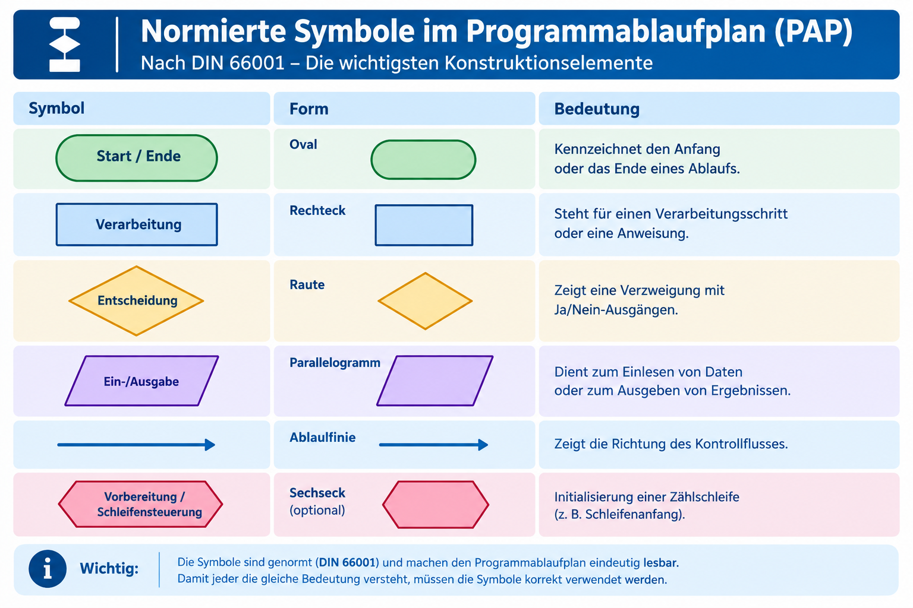
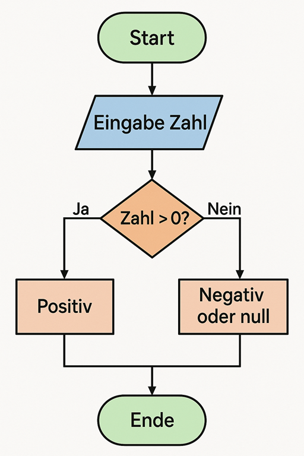
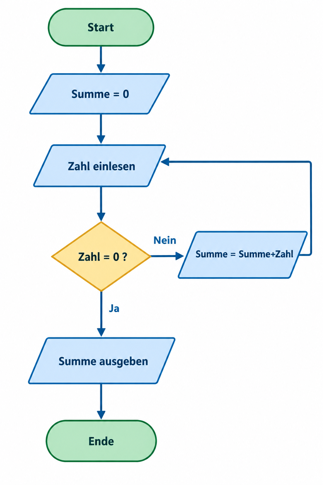

|                      |                           |                               |
| -------------------- | ------------------------- | ----------------------------- |
| **HF Systemtechnik** | **Softwareentwicklung A** |  |

- [1. Programmablaufplan (PAP)](#1-programmablaufplan-pap)
  - [1.1. Lernziele](#11-lernziele)
  - [1.2. Genormte Symbole (DIN 66001)](#12-genormte-symbole-din-66001)
  - [1.3. Grundregeln für einen korrekten PAP](#13-grundregeln-für-einen-korrekten-pap)
  - [1.4. Beispiel: Einfache Verzweigung](#14-beispiel-einfache-verzweigung)
  - [1.5. Beispiel: Schleife mit Abbruchbedingung](#15-beispiel-schleife-mit-abbruchbedingung)
  - [1.6. Struktogramm vs. PAP – wann welches Werkzeug?](#16-struktogramm-vs-pap--wann-welches-werkzeug)
  - [1.7. Mit draw.io einen Programmablaufplan (PAP) erstellen](#17-mit-drawio-einen-programmablaufplan-pap-erstellen)
- [2. Übungsaufgaben](#2-übungsaufgaben)
  - [2.1. PAP zeichnen](#21-pap-zeichnen)
  - [2.2. Vergleich anwenden](#22-vergleich-anwenden)
  - [2.3. Flowgorithm Einführung](#23-flowgorithm-einführung)

---

 

# 1. Programmablaufplan (PAP)

## 1.1. Lernziele

Nach diesem Kapitel können Sie:

- [ ] die genormten Symbole des PAP (DIN 66001) korrekt einsetzen
- [ ] die Grundregeln für einen korrekten PAP anwenden
- [ ] einen PAP mit Verzweigungen und Schleifen selbständig zeichnen
- [ ] Struktogramm und PAP situationsgerecht gegeneinander abwägen

## 1.2. Genormte Symbole (DIN 66001)

Der Programmablaufplan (PAP) nutzt genormte Symbole und eignet sich besonders, um Abläufe mit Sprüngen, Schleifen und mehreren Ein-/Ausstiegspunkten übersichtlich darzustellen – flexibler, aber auch weniger "diszipliniert erzwingend" als das Struktogramm.

| **Symbol**                      | **Form**            | **Bedeutung**                           |
| ------------------------------- | ------------------- | --------------------------------------- |
| Start/Ende                      | Oval                | Anfang bzw. Ende des Ablaufs            |
| Verarbeitung                    | Rechteck            | Ein Verarbeitungsschritt/eine Anweisung |
| Entscheidung                    | Raute               | Verzweigung mit Ja/Nein-Ausgängen       |
| Ein-/Ausgabe                    | Parallelogramm      | Daten werden eingelesen oder ausgegeben |
| Ablauflinie                     | Pfeil               | Richtung des Kontrollflusses            |
| Vorbereitung/Schleifensteuerung | Sechseck (optional) | Initialisierung einer Zählschleife      |

[Programmablaufplan Wiki](https://de.wikipedia.org/wiki/Programmablaufplan)

## 1.3. Grundregeln für einen korrekten PAP

1. **Genau ein Startsymbol.** Der Ablauf muss eindeutig beginnen.
2. **Mindestens ein Endsymbol** – auch mehrere sind zulässig (z. B. bei mehreren Abbruchpfaden), sollten aber sparsam eingesetzt werden.
3. **Jede Raute hat genau zwei Ausgänge** (Ja/Nein), die eindeutig beschriftet sind.
4. **Jeder Pfad muss geschlossen sein** – kein Pfeil endet "im Leeren".
5. **Konsistente Flussrichtung** – üblicherweise von oben nach unten, Rücksprünge (Schleifen) klar als solche erkennbar.

## 1.4. Beispiel: Einfache Verzweigung

**Aufgabe:** Zahl einlesen, prüfen ob positiv oder negativ.

## 1.5. Beispiel: Schleife mit Abbruchbedingung

**Aufgabe:** Zahlen einlesen und aufsummieren, bis "0" eingegeben wird; danach Summe ausgeben.

> **Hinweis zur Lesart:** Der Rücksprungpfeil von "Summe = Summe + Zahl" zurück zu "Zahl einlesen" bildet die Schleife. Genau diese Art von Rücksprung ist im Struktogramm (Kapitel 5) **nicht direkt als Pfeil darstellbar** – dort wird stattdessen der gesamte Schleifenkörper in ein umschliessendes Schleifenkästchen gepackt. Das ist der zentrale strukturelle Unterschied zwischen den beiden Werkzeugen.

## 1.6. Struktogramm vs. PAP – wann welches Werkzeug?

| **Kriterium**                                             | **Struktogramm**                    | **PAP**                                             |
| --------------------------------------------------------- | ----------------------------------- | --------------------------------------------------- |
| Erzwingt strukturierte Logik                              | Ja (keine freien Sprünge möglich)   | Nein (Sprünge frei possible)                        |
| Eignung für einfache, verschachtelte Logik                | Sehr gut                            | Gut, aber schnell unübersichtlich                   |
| Eignung für komplexe Abläufe mit mehreren Ein-/Ausstiegen | Eingeschränkt                       | Gut geeignet                                        |
| Verbreitung in der Ausbildung                             | Hoch (Deutschschweiz/D)             | Hoch, auch international (Flowchart)                |
| Bezug zu modernen Programmiersprachen                     | Direkt (if/while/for 1:1 abbildbar) | Indirekt, historisch näher an Assembler/Sprunglogik |

> **Praxisempfehlung:** Für die tägliche Arbeit als Systemtechniker/-in eignet sich das Struktogramm meist besser, um eine geplante Programmlogik **vor** der Umsetzung in C, C# oder Arduino zu strukturieren – der PAP eignet sich hingegen gut, um bestehende, bereits komplexere Abläufe (z. B. inkl. Fehlerbehandlung mit mehreren Abbruchpunkten) nachträglich zu dokumentieren.

## 1.7. Mit draw.io einen Programmablaufplan (PAP) erstellen

[Kleines Tutorial](https://www.youtube.com/watch?v=QmF2p_fUcnM)

---

# 2. Übungsaufgaben

## 2.1. PAP zeichnen

| **Vorgabe**         | **Beschreibung**                                                                |
| :------------------ | :------------------------------------------------------------------------------ |
| **Lernziele**       | PAP mit Verzweigung und Schleife korrekt darstellen, alle Grundregeln einhalten |
| **Sozialform**      | Partnerarbeit                                                                   |
| **Hilfsmittel**     | draw.io oder Papier                                                             |
| **Auftrag**         | siehe unten                                                                     |
| **Zeitbedarf**      | 35 min                                                                          |
| **Lösungselemente** | Vollständiger PAP mit allen 5 Standardsymbolen                                  |

**Aufgabenstellung:**

Zeichnen Sie einen PAP für folgende Aufgabe: Ein Programm liest wiederholt eine Note (1–6) ein. Ist die Note kleiner als 4, wird ein Zähler für "ungenügende Noten" erhöht. Die Eingabe endet, sobald der Wert "0" eingegeben wird. Am Schluss wird die Anzahl ungenügender Noten ausgegeben.

Prüfen Sie Ihren PAP anschliessend gegen die 5 Grundregeln

---

## 2.2. Vergleich anwenden

| **Vorgabe**    | **Beschreibung**         |
| :------------- | :----------------------- |
| **Sozialform** | Kurzdiskussion im Plenum |
| **Zeitbedarf** | 10 min                   |

**Aufgabenstellung:**

Diskutieren Sie: Für welches der beiden bisher behandelten Beispiele (Wasserkocher-Zustandsdiagramm aus Kapitel (Zustandsdiagramm) oder die obige Notenzählung) wäre der jeweils andere Modellierungsansatz (PAP vs. Zustandsdiagramm) **nicht** sinnvoll? Begründen Sie.

---

## 2.3. Flowgorithm Einführung

| **Vorgabe**         | **Beschreibung**                                    |
| :------------------ | :-------------------------------------------------- |
| **Lernziele**       | Kenn die Grundelemente eines Flowgorithm Programmes |
|                     | Kann ein Flowgorithm entwickeln                     |
|                     | Kann Algorithmen in Flowgorithm prüfen              |
| **Sozialform**      | Einzelarbeit                                        |
| **Auftrag**         | siehe unten                                         |
| **Hilfsmittel**     |                                                     |
| **Zeitbedarf**      | 30min                                               |
| **Lösungselemente** | Vollständiges Flowgorithm                           |

a)
Start das **Flowgorithm** und ändere die Sprache mit **F3** oder über das Menü "**Appearance->Change Language...**"  z.B. auf Deutsch.

b)
Rufe über das Menü "Hilfe->Dokumentation" die Online Hilfe auf und verschaffe Dir einen Überblick zu den "**Basic Shapes: Assignment, Declare, Input und Outpupt**"

c)
Schreibe ein PAP, in welchem zwei Werte eingelesen und der grössere Wert danach am Bildschirm angezeigt wird
Versuchen Sie diese Aufgabe mit **Flowgorithm** zu lösen.

---

© 2026 Lukas Müller – Licensed under CC BY-NC-ND 4.0
See [LICENSE](..\license.md) file for details.
