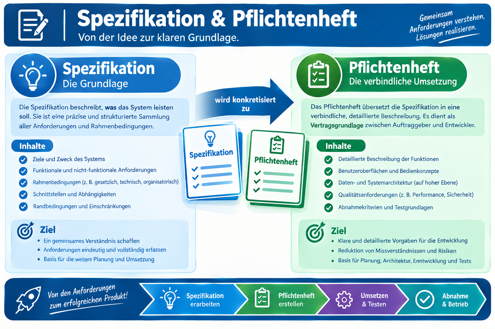

|                      |                           |                               |
| -------------------- | ------------------------- | ----------------------------- |
| **HF Systemtechnik** | **Softwareentwicklung A** |  |

- [1. Spezifikation (Pflichtenheft)](#1-spezifikation-pflichtenheft)
  - [1.1. Lernziele](#11-lernziele)
  - [1.2. Zweck der Spezifikation](#12-zweck-der-spezifikation)
    - [1.2.1. Lastenheft vs. Pflichtenheft](#121-lastenheft-vs-pflichtenheft)
  - [1.3. Bestandteile einer Spezifikation](#13-bestandteile-einer-spezifikation)
    - [1.3.1. Funktionale vs. nicht-funktionale Anforderungen](#131-funktionale-vs-nicht-funktionale-anforderungen)
    - [1.3.2. Priorisierung: MoSCoW-Methode](#132-priorisierung-moscow-methode)
  - [1.4. Kriterien für gute Anforderungen](#14-kriterien-für-gute-anforderungen)
    - [1.4.1. Negativbeispiele – typische Formulierungsfehler](#141-negativbeispiele--typische-formulierungsfehler)
  - [1.5. Vorgehen zur Erstellung einer Spezifikation](#15-vorgehen-zur-erstellung-einer-spezifikation)
- [2. Übungsaufgaben](#2-übungsaufgaben)
  - [2.1. Spezifikation erstellen](#21-spezifikation-erstellen)
  - [2.2. Anforderungen korrigieren](#22-anforderungen-korrigieren)

---

 

# 1. Spezifikation (Pflichtenheft)

## 1.1. Lernziele

Nach diesem Kapitel können Sie:

- [ ] Zweck und Inhalt einer Spezifikation (Pflichtenheft) erklären
- [ ] Lastenheft und Pflichtenheft voneinander abgrenzen
- [ ] funktionale und nicht-funktionale Anforderungen unterscheiden und Beispiele zuordnen
- [ ] Kriterien für gute (eindeutige, testbare) Anforderungen anwenden
- [ ] für eine einfache Aufgabenstellung selbständig eine Spezifikation verfassen

## 1.2. Zweck der Spezifikation

Eine **Spezifikation** beschreibt, **was** eine Software leisten soll – nicht **wie** sie es tut. Sie ist die zentrale Schnittstelle zwischen Auftraggeber/-in und Entwickler/-in und der wichtigste Ausgangspunkt jedes Projekts (siehe Kapitel 2.2, Phase "Anforderungsanalyse").

### 1.2.1. Lastenheft vs. Pflichtenheft

In der Praxis werden oft zwei Dokumente unterschieden, die häufig verwechselt werden:

|              | **Lastenheft**                                       | **Pflichtenheft**                                         |
| ------------ | ---------------------------------------------------- | --------------------------------------------------------- |
| Verfasst von | Auftraggeber/-in                                     | Auftragnehmer/-in (Entwickler/-in)                        |
| Inhalt       | **Was** wird gewünscht (aus Sicht des Auftraggebers) | **Wie** wird es umgesetzt (Antwort des Auftragnehmers)    |
| Detailgrad   | Eher grob, fachlich                                  | Detailliert, auch technisch                               |
| Funktion     | Ausschreibungsgrundlage                              | Verbindliche Umsetzungsgrundlage, oft Vertragsbestandteil |

> **Merkhilfe:** Das Lastenheft beschreibt die **Last** (Aufgabe), die der Auftraggeber "abgeben" möchte. Das Pflichtenheft beschreibt die **Pflichten**, die sich der Auftragnehmer zur Erfüllung dieser Last auferlegt.

In diesem Kurs verwenden wir vereinfacht den Begriff **Spezifikation** für ein kompaktes, praxistaugliches Dokument, das die wichtigsten Elemente beider Dokumente in einer für kleinere Projekte angemessenen Form vereint.

## 1.3. Bestandteile einer Spezifikation

| Element                             | Inhalt                                                                        |
| ----------------------------------- | ----------------------------------------------------------------------------- |
| **Ausgangslage**                    | Warum wird die Software gebraucht? Welches Problem löst sie?                  |
| **Funktionale Anforderungen**       | Was muss die Software tun? (Muss-/Soll-/Kann-Kriterien)                       |
| **Nicht-funktionale Anforderungen** | Wie schnell, wie sicher, wie bedienbar, wie zuverlässig?                      |
| **Abgrenzung**                      | Was gehört ausdrücklich **nicht** dazu?                                       |
| **Schnittstellen**                  | Womit muss die Software zusammenarbeiten (Dateien, andere Systeme, Hardware)? |
| **Randbedingungen**                 | Vorgaben zu Plattform, Budget, Zeitrahmen, Vorschriften                       |

### 1.3.1. Funktionale vs. nicht-funktionale Anforderungen

**Funktionale Anforderungen** beschreiben, **was** das System tun soll – konkrete Funktionen und Verhalten.

> Beispiel: "Das System muss aus einer CSV-Datei die Tagesproduktion importieren können."

**Nicht-funktionale Anforderungen** beschreiben **Qualitätseigenschaften**, unter denen die Funktion erbracht werden muss.

> Beispiel: "Der Import einer Datei mit 10'000 Zeilen darf nicht länger als 5 Sekunden dauern." / "Die Anwendung muss auch von Personen ohne IT-Vorkenntnisse bedienbar sein."

| **Kategorie nicht-funktionaler Anforderungen** | **Beispiel**                             |
| ---------------------------------------------- | ---------------------------------------- |
| Performance                                    | Antwortzeit, Durchsatz                   |
| Benutzbarkeit                                  | Bedienbarkeit, Sprache, Barrierefreiheit |
| Zuverlässigkeit                                | Verfügbarkeit, Fehlertoleranz            |
| Sicherheit                                     | Zugriffsschutz, Datenschutz              |
| Wartbarkeit                                    | Erweiterbarkeit, Dokumentation           |

### 1.3.2. Priorisierung: MoSCoW-Methode

Eine bewährte, einfache Priorisierung von Anforderungen ist die **MoSCoW-Methode**:

| **Kürzel**                 | **Bedeutung**                                           |
| -------------------------- | ------------------------------------------------------- |
| **M**ust have              | Zwingend erforderlich, ohne dies ist die Lösung wertlos |
| **S**hould have            | Wichtig, aber nicht zwingend für die erste Version      |
| **C**ould have             | Wünschenswert, wird umgesetzt, wenn Zeit/Budget reichen |
| **W**on't have (this time) | Bewusst ausgeschlossen für diese Version                |

## 1.4. Kriterien für gute Anforderungen

Eine Anforderung ist nur dann brauchbar, wenn sie folgende Kriterien erfüllt:

- **Eindeutig** – lässt keinen Interpretationsspielraum zu
- **Testbar** – man kann objektiv prüfen, ob sie erfüllt ist
- **Widerspruchsfrei** – steht nicht im Konflikt zu anderen Anforderungen
- **Vollständig** – lässt keine wichtigen Fälle offen (auch Sonder-/Fehlerfälle!)
- **Nachvollziehbar** – ist einer Quelle/einem Bedürfnis zuordenbar

### 1.4.1. Negativbeispiele – typische Formulierungsfehler

| **Schlechte Formulierung**                      | **Problem**                                        | **Bessere Formulierung**                                                                                                         |
| ----------------------------------------------- | -------------------------------------------------- | -------------------------------------------------------------------------------------------------------------------------------- |
| "Das System soll schnell sein."                 | Nicht testbar (was heisst "schnell"?)              | "Das System muss eine Anfrage innerhalb von 2 Sekunden beantworten."                                                             |
| "Das System soll benutzerfreundlich sein."      | Nicht eindeutig                                    | "Ein/e neue/r Anwender/-in kann die Kernfunktion ohne Schulung innert 5 Minuten ausführen."                                      |
| "Fehlerhafte Daten werden irgendwie behandelt." | Nicht eindeutig, keine konkrete Handlungsanweisung | "Bei fehlerhaftem Dateiformat wird eine Fehlermeldung angezeigt und der Import abgebrochen, ohne bestehende Daten zu verändern." |

> **Wichtig:** Genau diese Art von unklaren Formulierungen ist – wie in Kapitel 1.3 gezeigt – die häufigste Ursache für gescheiterte oder verzögerte Softwareprojekte.

## 1.5. Vorgehen zur Erstellung einer Spezifikation

Eine bewährte Vorgehensweise zur systematischen Anforderungserhebung ist die **W-Fragen-Technik**:

1. **Wer** nutzt die Software? (Zielgruppe, Vorkenntnisse)
2. **Was** soll die Software leisten? (Kernfunktionen)
3. **Warum** wird sie gebraucht? (Ausgangslage, Nutzen)
4. **Wie** soll die Bedienung erfolgen? (grobe Vorstellung, ohne bereits die technische Umsetzung festzulegen)
5. **Womit** muss sie zusammenarbeiten? (Schnittstellen, Dateiformate, andere Systeme)
6. **Was nicht?** (bewusste Abgrenzung)

> **Praxistipp:** Halten Sie in einem ersten Gespräch mit dem/der Auftraggeber/-in bewusst offene Fragen, statt bereits Lösungen vorzuschlagen. Die häufigste Falle ist, dass Auftraggeber und Entwickler zu früh über eine konkrete technische Lösung statt über das eigentliche Bedürfnis sprechen.

---

 

# 2. Übungsaufgaben

## 2.1. Spezifikation erstellen

| **Vorgabe**         | **Beschreibung**                                                   |
| :------------------ | :----------------------------------------------------------------- |
| **Lernziele**       | Eine einfache Spezifikation selbständig und strukturiert verfassen |
| **Sozialform**      | Einzelarbeit                                                       |
| **Auftrag**         | siehe unten                                                        |
| **Hilfsmittel**     | Struktur aus Kapitel 3.2                                           |
| **Zeitbedarf**      | 30 min                                                             |
| **Lösungselemente** | Vollständige, strukturierte Spezifikation (ca. 1 Seite)            |

**Aufgabenstellung:**

Verfassen Sie eine Spezifikation für ein Tool, das aus einer Liste von Werkzeugen (Name, Standort, Zustand: verfügbar/in Wartung/ausgemustert) die aktuell **verfügbaren** Werkzeuge anzeigt. Verwenden Sie die Struktur aus obigen Kapitel (Ausgangslage, funktionale/nicht-funktionale Anforderungen mit MoSCoW-Priorisierung, Abgrenzung, Schnittstellen).

---

## 2.2. Anforderungen korrigieren

| **Vorgabe**    | **Beschreibung**                                            |
| :------------- | :---------------------------------------------------------- |
| **Lernziele**  | Schlecht formulierte Anforderungen erkennen und korrigieren |
| **Sozialform** | Partnerarbeit                                               |
| **Zeitbedarf** | 20 min                                                      |

**Aufgabenstellung:**

Die folgenden vier Anforderungen sind schlecht formuliert. Bestimmen Sie jeweils das Problem (fehlende Eindeutigkeit, fehlende Testbarkeit, o. ä.) und formulieren Sie eine bessere Version:

1. "Das Programm soll stabil laufen."
2. "Fehler sollen dem Benutzer angezeigt werden."
3. "Die Software muss modern aussehen."
4. "Grosse Dateien sollen unterstützt werden."

---

© 2026 Lukas Müller – Licensed under CC BY-NC-ND 4.0
See [LICENSE](..\license.md) file for details.
