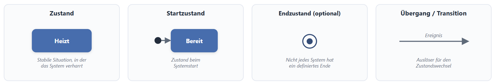
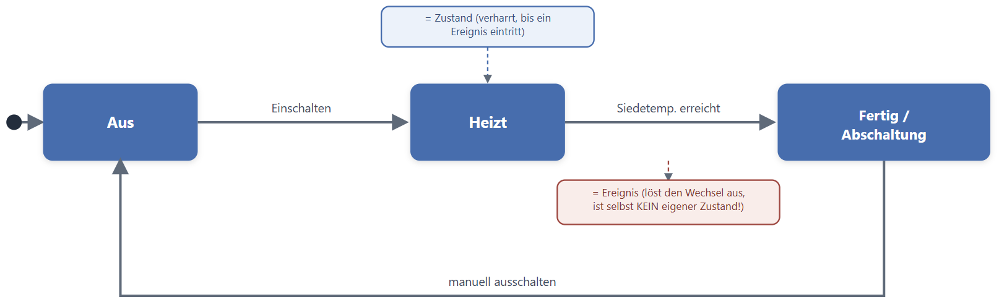
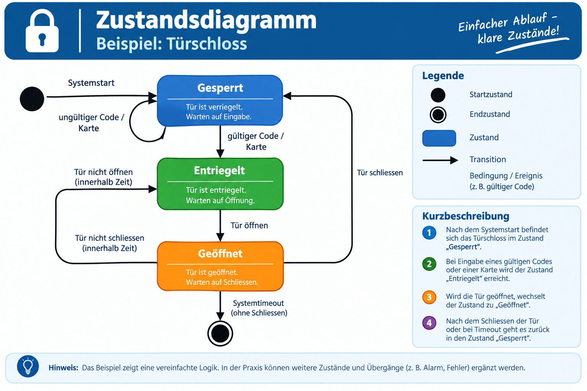

|                      |                           |                               |
| -------------------- | ------------------------- | ----------------------------- |
| **HF Systemtechnik** | **Softwareentwicklung A** |  |

- [1. Zustandsdiagramm](#1-zustandsdiagramm)
  - [1.1. Lernziele](#11-lernziele)
  - [1.2. Zustand und Ereignis – die Grundbegriffe](#12-zustand-und-ereignis--die-grundbegriffe)
  - [1.3. Notationselemente](#13-notationselemente)
  - [1.4. Regeln für korrekte Zustandsdiagramme](#14-regeln-für-korrekte-zustandsdiagramme)
  - [1.5. Beispiel: Wasserkocher](#15-beispiel-wasserkocher)
  - [1.6. Erweitertes Beispiel: Fussgängerampel mit Anforderungstaster](#16-erweitertes-beispiel-fussgängerampel-mit-anforderungstaster)
  - [1.7. Typische Fehler bei Zustandsdiagrammen](#17-typische-fehler-bei-zustandsdiagrammen)
  - [1.8 Beispiel - Türschloss](#18-beispiel---türschloss)
  - [1.9 Beispiel - Bankomathochlauf](#19-beispiel---bankomathochlauf)
- [2. Übungsaufgaben](#2-übungsaufgaben)
  - [2.1. Zustandsdiagramm zeichnen](#21-zustandsdiagramm-zeichnen)
  - [2.2. Vollständigkeit prüfen](#22-vollständigkeit-prüfen)

---

</br>

# 1. Zustandsdiagramm

## 1.1. Lernziele

Nach diesem Kapitel können Sie:

- [ ] Zustände und Ereignisse eines Systems klar unterscheiden
- [ ] die Notationselemente eines Zustandsdiagramms korrekt anwenden
- [ ] ein Zustandsdiagramm für ein einfaches, reales System selbständig zeichnen
- [ ] typische Fehler bei der Modellierung von Zustandsdiagrammen erkennen
- [ ] die Vollständigkeit eines Zustandsdiagramms prüfen (jeder Zustand hat einen definierten Ausgang für jedes relevante Ereignis)

## 1.2. Zustand und Ereignis – die Grundbegriffe

Ein Zustandsdiagramm zeigt eine Folge von Zuständen, die ein Objekt im Laufe seines Lebens einnehmen kann, und die Ursachen der Zustandsänderungen. Man kann für ein Objekt den Zustand und die Änderung des Zustandes in Abhängigkeit von ausgeführten Operationen modellieren. Dabei wird besonderer Wert auf die Übergänge von einem Zustand in den nächsten gelegt. Man kann so ein Objekt von der Initialisierung bis zur Freigabe modellieren. Das Zustandsdiagramm beschreibt, durch welche Operationen oder Ereignisse die Zustände des Objekts geändert werden. Weiters ist aus ihnen ersichtlich, welche Belegung die Attribute des Objekts vor dem Übergang besitzen oder besitzen müssen.

Viele technische und softwaretechnische Systeme lassen sich als endliche Anzahl **Zustände** beschreiben, zwischen denen **Ereignisse** Übergänge auslösen.

- **Zustand:** Eine stabile Situation, in der sich das System über eine gewisse Zeit befindet (z. B. "Aus", "Heizt", "Fertig"). Ein Zustand ändert sich nicht von selbst.
- **Ereignis (Übergang/Transition):** Ein Auslöser, der das System von einem Zustand in einen anderen überführt (z. B. "Taste gedrückt", "Temperatur erreicht", "Zeit abgelaufen").

> **Häufigste Verwechslung:** "Heizt" ist ein **Zustand** (das System verharrt darin, bis etwas passiert). "Siedetemperatur erreicht" ist das **Ereignis**, das den Übergang in einen anderen Zustand auslöst – nicht der Zustand selbst. In Prüfungen wird diese Verwechslung besonders häufig bestraft, da sie zeigt, dass das Konzept nicht verstanden wurde.

[Wiki](https://de.wikipedia.org/wiki/Zustandsdiagramm_(UML))

## 1.3. Notationselemente

| **Element**         | **Darstellung**                                 | **Bedeutung**                                          |
| ------------------- | ----------------------------------------------- | ------------------------------------------------------ |
| Zustand             | Rechteck mit abgerundeten Ecken (oder Kreis)    | Stabile Situation des Systems                          |
| Startzustand        | Ausgefüllter Punkt mit Pfeil zum ersten Zustand | Zustand beim Systemstart                               |
| Endzustand          | Punkt mit Kreisrand ("Bullseye")                | Optional – nicht jedes System hat ein definiertes Ende |
| Übergang/Transition | Beschrifteter Pfeil                             | Ereignis, das den Zustandswechsel auslöst              |



## 1.4. Regeln für korrekte Zustandsdiagramme

1. **Genau ein Startzustand** – das System muss bei Beginn eindeutig in einem definierten Zustand sein.
2. **Determinismus** – von einem Zustand darf für ein bestimmtes Ereignis nur genau ein Übergang existieren (sonst wäre unklar, was passiert).
3. **Vollständigkeit prüfen** – für jeden Zustand sollte überlegt werden: Gibt es Ereignisse, die auftreten könnten, aber im Diagramm fehlen? (z. B. Fehlerfall, Abbruch)
4. **Sprechende Beschriftung** – Zustände als Substantive/Adjektive ("Heizt", "Bereit"), Ereignisse als Vorgänge ("Taste gedrückt", "Zeit abgelaufen").

## 1.5. Beispiel: Wasserkocher



Diskussionswürdig: Was passiert, wenn während "Heizt" kein Wasser im Kocher ist (Trockengehschutz)? Dieses Ereignis fehlt bewusst im Grundmodell und eignet sich als Erweiterungsdiskussion (siehe Übung 4.2).

## 1.6. Erweitertes Beispiel: Fussgängerampel mit Anforderungstaster

```bash
   ●──►┌───────┐  Taste gedrückt   ┌─────────────┐  Zeit T1 abgelaufen  ┌─────────┐
       │  Rot  │──────────────────►│ Rot wartend │─────────────────────►│  Grün   │
       └───────┘                   └─────────────┘                      └────┬────┘
            ▲                                                                │ Zeit T2 abgelaufen
            │                          Zeit T3 abgelaufen                    ▼
            │                     ┌────────────┐                       ┌─────────┐
            └─────────────────────│    Rot     │◄──────────────────────│  Gelb   │
                                  └────────────┘                       └─────────┘
```

Hier zeigt sich ein zusätzlich wichtiger Punkt: Der Zustand "Rot wartend" existiert bewusst getrennt von "Rot", da während dieser Zeit eine feste Wartezeit (T1) abläuft, bevor auf Grün gewechselt werden darf – unabhängig davon, ob die Taste erneut gedrückt wird.

## 1.7. Typische Fehler bei Zustandsdiagrammen

| **Fehler**                       | **Beispiel**                                                                         | **Korrektur**                                                |
| -------------------------------- | ------------------------------------------------------------------------------------ | ------------------------------------------------------------ |
| Zustand und Ereignis vertauscht  | "Taste gedrückt" als Zustand modelliert                                              | Ereignis als Pfeilbeschriftung, nicht als Kästchen           |
| Fehlender Startzustand           | Diagramm beginnt unklar                                                              | Startpunkt eindeutig markieren                               |
| Nicht-deterministische Übergänge | Zwei Pfeile mit demselben Ereignis aus demselben Zustand zu unterschiedlichen Zielen | Bedingung präzisieren oder Zustände weiter aufteilen         |
| Unvollständigkeit                | Fehlerfall (z. B. Sensorausfall) nicht berücksichtigt                                | Bewusst prüfen, ob alle relevanten Ereignisse abgedeckt sind |

## 1.8 Beispiel - Türschloss



## 1.9 Beispiel - Bankomathochlauf


---

</br>

# 2. Übungsaufgaben

## 2.1. Zustandsdiagramm zeichnen

| **Vorgabe**         | **Beschreibung**                                                                              |
| :------------------ | :-------------------------------------------------------------------------------------------- |
| **Lernziele**       | Zustände und Ereignisse korrekt identifizieren und in einem vollständigen Diagramm darstellen |
| **Sozialform**      | Partnerarbeit (2 Personen)                                                                    |
| **Hilfsmittel**     | Papier oder draw.io                                                                           |
| **Auftrag**         | siehe unten                                                                                   |
| **Zeitbedarf**      | 30 min                                                                                        |
| **Lösungselemente** | Vollständiges Zustandsdiagramm mit mind. 4 Zuständen und 4 Übergängen                         |

**Aufgabenstellung:**

Zeichnen Sie ein vollständiges Zustandsdiagramm für eine automatische Schiebetür mit Bewegungssensor:

- Die Tür ist im Normalfall **geschlossen**.
- Erkennt der Sensor eine Person, **öffnet** die Tür.
- Ist die Tür vollständig offen, bleibt sie für eine feste Zeit **offen**.
- Nach Ablauf der Zeit **schliesst** sie wieder – ausser der Sensor erkennt erneut eine Person, dann bleibt sie offen.

---

## 2.2. Vollständigkeit prüfen

| **Vorgabe**    | **Beschreibung**                                                 |
| :------------- | :--------------------------------------------------------------- |
| **Lernziele**  | Unvollständigkeiten in einem gegebenen Zustandsdiagramm erkennen |
| **Sozialform** | Klassendiskussion / Einzelarbeit                                 |
| **Zeitbedarf** | 15 min                                                           |

**Aufgabenstellung:**

Betrachten Sie das Wasserkocher-Diagramm. Nennen Sie mindestens zwei reale Ereignisse, die im Diagramm fehlen, und schlagen Sie vor, wie das Diagramm ergänzt werden müsste.

---

© 2026 Lukas Müller – Licensed under CC BY-NC-ND 4.0
See [LICENSE](..\license.md) file for details.
