|                      |                           |                               |
| -------------------- | ------------------------- | ----------------------------- |
| **HF Systemtechnik** | **Softwareentwicklung A** |  |

- [1. Struktogramm (Nassi-Shneiderman-Diagramm)](#1-struktogramm-nassi-shneiderman-diagramm)
  - [1.1. Lernziele](#11-lernziele)
  - [1.2. Zweck und Grundprinzip](#12-zweck-und-grundprinzip)
  - [1.3. Wozu Struktogramme](#13-wozu-struktogramme)
  - [1.4. Vorgehen](#14-vorgehen)
  - [1.5. Die drei Grundelemente](#15-die-drei-grundelemente)
    - [1.5.1. Sequenz](#151-sequenz)
    - [1.5.2. Verzweigung / Alternation (einfach: if/else)](#152-verzweigung--alternation-einfach-ifelse)
    - [1.5.3. Mehrfachverzweigung (case/switch)](#153-mehrfachverzweigung-caseswitch)
    - [1.5.4. Schleife – kopfgesteuert (while)](#154-schleife--kopfgesteuert-while)
    - [1.5.5. Schleife – fussgesteuert (do-while)](#155-schleife--fussgesteuert-do-while)
    - [1.5.6. Spezialform (Zählschleife)](#156-spezialform-zählschleife)
    - [1.5.7. Prozedur Aufruf (Unterprogramm)](#157-prozedur-aufruf-unterprogramm)
  - [1.6. Verschachtelung](#16-verschachtelung)
  - [1.7. Zusammenfassung](#17-zusammenfassung)
  - [1.8. Struktogramm vs. Zustandsdiagramm – bewusste Abgrenzung](#18-struktogramm-vs-zustandsdiagramm--bewusste-abgrenzung)
  - [1.9 Online-Tools für Struktogramme (Nassi-Shneiderman-Diagramme)](#19-online-tools-für-struktogramme-nassi-shneiderman-diagramme)
    - [1.9.1 Nassi-Designer](#191-nassi-designer)
    - [1.9.2 VisuStruct](#192-visustruct)
- [2. Übungsaufgaben](#2-übungsaufgaben)
  - [2.1. Struktogramm zu einer Verzweigung](#21-struktogramm-zu-einer-verzweigung)
  - [2.2. Struktogramm mit Schleife](#22-struktogramm-mit-schleife)

--

 

# 1. Struktogramm (Nassi-Shneiderman-Diagramm)

## 1.1. Lernziele

Nach diesem Kapitel können Sie:

- [ ] den Zweck und das Grundprinzip des Struktogramms erklären
- [ ] die drei Grundelemente (Sequenz, Verzweigung, Schleife) korrekt zeichnen
- [ ] einfache und mehrfache Verzweigungen sowie kopf-/fussgesteuerte Schleifen unterscheiden
- [ ] verschachtelte Strukturen in einem Struktogramm darstellen
- [ ] für eine gegebene Aufgabenstellung ein vollständiges Struktogramm erstellen

---

## 1.2. Zweck und Grundprinzip

Das **Struktogramm** (auch Nassi-Shneiderman-Diagramm, nach seinen Erfindern Isaac Nassi und Ben Shneiderman) stellt den **Kontrollfluss** eines Programms als verschachtelte Kästchen dar – bewusst **ohne Pfeile**. Das erzwingt eine strukturierte, disziplinierte Programmlogik ohne wilde Sprünge ("Spaghetticode"), da im Struktogramm ein unstrukturierter Sprung schlicht nicht darstellbar ist.

> **Historischer Hintergrund:** Das Struktogramm entstand in den 1970er-Jahren im Umfeld der "strukturierten Programmierung" – einer Bewegung, die den unkontrollierten Einsatz des `GOTO`-Befehls zugunsten klar verschachtelter Kontrollstrukturen (Sequenz, Verzweigung, Schleife) zurückdrängen wollte. Dieses Prinzip ist bis heute Grundlage praktisch jeder modernen Programmiersprache.

---

## 1.3. Wozu Struktogramme

Strukturiertes Vorgehen

- Erst die Struktur des Programms entwickeln, dann Programm schreiben.
- Fehler vermeiden
- Strukturiertes Vorgehen statt trial and error.
- Bevor man das Programm schreibt, macht man sich
- Gedanken zum Aufbau und Ablauf des Algorithmus.
- Übersichtliche Darstellung unabhängig von der Programmiersprache.
- Programme, die entsprechend eines Struktogramms implementiert werden, sind in ihrem Aufbau und ihrer Logik leichter überschaubar.

---

## 1.4. Vorgehen

- Ein Struktogramm wird von **oben nach unten gelesen**
- Die Teilalgorithmen bzw. Anweisungen werden in Form von Rechtecken dargestellt
- Jedes Struktogramm hat jeweils einen Eingang (obere Kante) und einen Ausgang (untere Kante)
- Der Ausgang des einen Segments ist der Eingang des nachfolgenden
- Man beginnt mit einem Grobentwurf und verfeinert diesen schrittweise, d.h. eine Anweisung wird durch einen Teilalgorithmus ersetzt
- Struktogramme können verschachtelt werden. Überall dort, wo eine Anweisung stehen darf, kann ein Teilalgorithmus oder ein ganzes Struktogramm eingefügt werden

---

## 1.5. Die drei Grundelemente

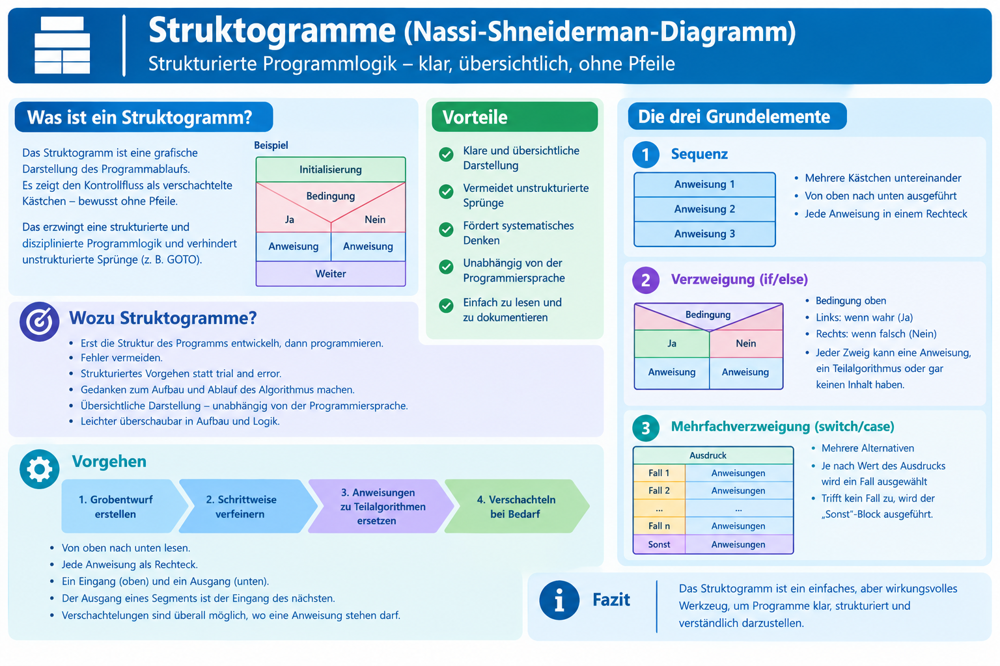

### 1.5.1. Sequenz

- Mehrere Kästchen werden einfach **untereinander** angeordnet und nacheinander ausgeführt.
- Pro Anweisung gibt es ein **Rechteck**
- Die Anweisungen werden von oben nach unten abgearbeitet
- Eine oder mehrere Anweisungen werden nacheinander ausgeführt.

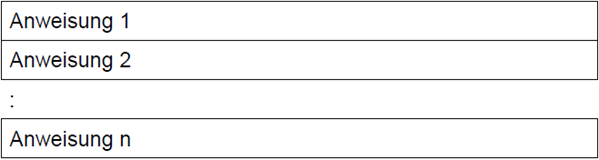

**Beispiel:**

[Beispiel Sequenz](./x_gitres/struktogramm-sequenz-beispiel.png)

### 1.5.2. Verzweigung / Alternation (einfach: if/else)

- Sollen Anweisungen nur in Abhängigkeit von bestimmten **Bedingungen** ausgeführt werden, verwendet man eine Auswahl bzw. Verzweigung
  - Die Bedingung steht oben
  - **Link**, wenn wahr
  - **Rechts**, wenn falsch
- Ist die Bedingung wahr, so wird der **"WAHR"**-Block ausgeführt, ansonsten, der **"FALSCH"**-Block
- Jeder der Blöcke
  - kann eine Anweisung
  - ein Teilalgorithmus
  - ein ganzes Struktogramm oder auch keine Anweisung (Bedingte Auswahl) enthalten
- Wird als Rechteck, das in zwei Zweige geteilt ist dargestellt.

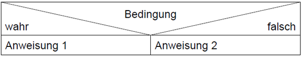

Es kann auch nur ein Anweisungsblock (wahr oder falsch) ausgeführt werden.

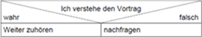

### 1.5.3. Mehrfachverzweigung (case/switch)

- Auch Fallunterscheidung genannt
- Mehrere Alternativen werden berücksichtigt
- Je nachdem, welchen Wert der Ausdruck enthält, wird einer der Fälle ausgewählt
- Trifft keiner der Fälle zu, wird der „SONST“-Block ausgeführt
- Wird als Rechteck mit mehreren horizontalen Bereichen für die **verschiedenen Fälle** dargestellt

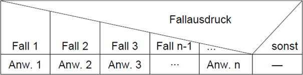

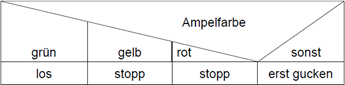

### 1.5.4. Schleife – kopfgesteuert (while)

Die Bedingung wird **vor** jeder Wiederholung geprüft – der Schleifenkörper kann dadurch **null Mal** ausgeführt werden.

- Am Anfang der Iteration steht eine Eintrittsbedingung
- Kopfgesteuerte Iteration (solange)
- Die Bedingung wird **zuerst geprüft**. Nur wenn sie wahr ist, wird der Schleifenblock ausgeführt.
- Der anschliessende Teilalgorithmus wird wiederholt, solang die Bedingung erfüllt ist
- Ist die Bedingung von Beginn an nicht erfüllt, kommt der Teilalgorithmus auch nicht zur Ausführung

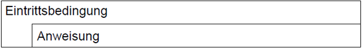

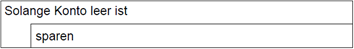

### 1.5.5. Schleife – fussgesteuert (do-while)

Der Teilalgorithmus wird ausgeführt, solange die **Wiedereintrittsbedingung** erfüllt ist

- Schleifenbedingung steht unten
- Der Block wird **mindestens einmal** ausgeführt, danach wird geprüft.
- Ist die Bedingung nichtmehr erfüllt, wird die Wiederholung beendet
- Der Teilalgorithmus wird mindestens einmal ausgeführt.

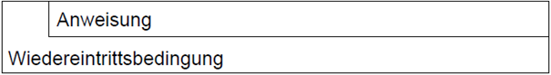

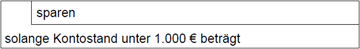

> **Wichtiger Unterschied für Prüfungen:** Kopfgesteuerte Schleifen prüfen **vorher** (0-n Durchläufe möglich), fussgesteuerte Schleifen prüfen **nachher** (immer mindestens 1 Durchlauf). Die Wahl der falschen Schleifenart ist eine der häufigsten Fehlerquellen bei Programmieranfängern.

### 1.5.6. Spezialform (Zählschleife)

Eine **Zählschleife** (auch zählende Schleife genannt) ist eine Schleifenform, bei der eine Schleifenvariable schrittweise verändert wird, bis eine bestimmte Anzahl von Durchläufen erreicht ist.

- Man verwendet sie, wenn man **genau weiss, wie oft** eine Wiederholung stattfinden soll.
- Wird häufig verwendet, um von A bis B zu zählen

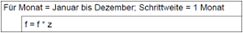

### 1.5.7. Prozedur Aufruf (Unterprogramm)

Der Aufruf einer **Prozedur** oder einer Methode, die wiederum aus einer Menge von Anweisungen bestehen kann, wird durch die Doppelstriche am Rand des Strukturblocks dargestellt.
Nach deren Durchlauf wird zu der aufrufenden Stelle zurückgesprungen und der nächstfolgende Strukturblock durchlaufen. Dieses Symbol ist nicht genormt

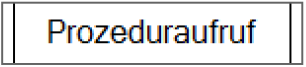

---

## 1.6. Verschachtelung

Struktogramme können beliebig tief verschachtelt werden – ein Element kann selbst wieder eine Verzweigung oder Schleife enthalten. Dies bildet reale, komplexere Programmlogik ab.

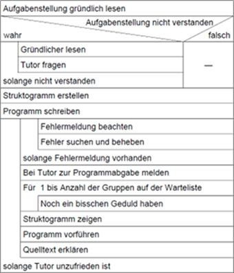

---

## 1.7. Zusammenfassung

Komplexe Abläufe werden durch Schachtelung von Kontrollstrukturen beschrieben

- Innerhalb von Schleifen können wieder Schleifen oder Auswahlanweisungen stehen
- Kontrollstrukturen können in beliebiger Kombination beliebig tief ineinander verschachtelt werden
- Funktionen werden in einem separaten Struktogramm dargestellt

> **Immer vom Groben zum Feinen Anweisungen durch Teilalgorithmen ersetzen, dann geht nichts schief!**

---

## 1.8. Struktogramm vs. Zustandsdiagramm – bewusste Abgrenzung

Ein häufiges Missverständnis bei Einsteigern: Struktogramm und Zustandsdiagramm sehen beide nach "Kästchen mit Verbindungen" aus, modellieren aber **völlig unterschiedliche Dinge**.

|                    | **Zustandsdiagramm**                                      | **Struktogramm**                                       |
| ------------------ | --------------------------------------------------------- | ------------------------------------------------------ |
| Modelliert         | **Zustände** eines Systems über die Zeit                  | **Ablauflogik innerhalb eines Programmschritts**       |
| Zeithorizont       | Das System kann beliebig lange in einem Zustand verharren | Wird i. d. R. in einem Durchlauf komplett abgearbeitet |
| Typisches Beispiel | Ampelphasen, Türsteuerung                                 | Ein Algorithmus wie "Klassifiziere Temperatur"         |

---

## 1.9 Online-Tools für Struktogramme (Nassi-Shneiderman-Diagramme)

### 1.9.1 Nassi-Designer

Unterstützt Sequenzen, Alternativen, While-, Do-While- und For-Schleifen. Export als PNG und PDF. Besonders interessant für Lehrpersonen und Lernende.
[Nassi-Designer](https://nassi.exploki.de/app/)

### 1.9.2 VisuStruct

Ermöglicht das Erstellen von Struktogrammen, die schrittweise Simulation und die Codegenerierung für Java, Python und JavaScript. 

[VisuStruct](https://visustruct.org/en/index.html)

---

 

# 2. Übungsaufgaben

## 2.1. Struktogramm zu einer Verzweigung

| **Vorgabe**         | **Beschreibung**                               |
| :------------------ | :--------------------------------------------- |
| **Lernziele**       | Verzweigung im Struktogramm korrekt darstellen |
| **Sozialform**      | Einzelarbeit                                   |
| **Zeitbedarf**      | 20 min                                         |
| **Lösungselemente** | Vollständiges Struktogramm                     |

**Aufgabenstellung:**

Erstellen Sie ein Struktogramm für folgende Aufgabe: Ein Programm liest eine Temperatur ein. Ist sie unter 0 °C, wird "Frost" ausgegeben, zwischen 0 °C und 25 °C "Normal", über 25 °C "Warm".

---

## 2.2. Struktogramm mit Schleife

| **Vorgabe**         | **Beschreibung**                                               |
| :------------------ | :------------------------------------------------------------- |
| **Lernziele**       | Kopf- und fussgesteuerte Schleifen situationsgerecht einsetzen |
| **Sozialform**      | Partnerarbeit                                                  |
| **Zeitbedarf**      | 30 min                                                         |
| **Lösungselemente** | Struktogramm inkl. Begründung der Schleifenwahl                |

**Aufgabenstellung:**

Erstellen Sie ein Struktogramm für ein Programm, das so lange Zahlen von der Tastatur einliest und aufsummiert, bis eine "0" eingegeben wird. Anschliessend wird die Summe ausgegeben.

1. Entscheiden Sie sich bewusst für eine kopf- oder fussgesteuerte Schleife und begründen Sie Ihre Wahl.
2. Was ändert sich, wenn garantiert mindestens eine Zahl ≠ 0 eingegeben wird, bevor die Abbruchbedingung eintreten kann?

---

© 2026 Lukas Müller – Licensed under CC BY-NC-ND 4.0
See [LICENSE](..\license.md) file for details.
