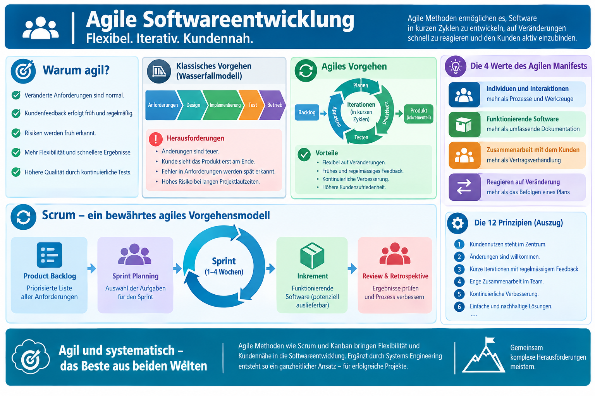
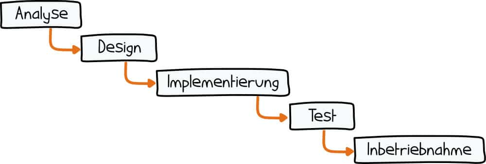
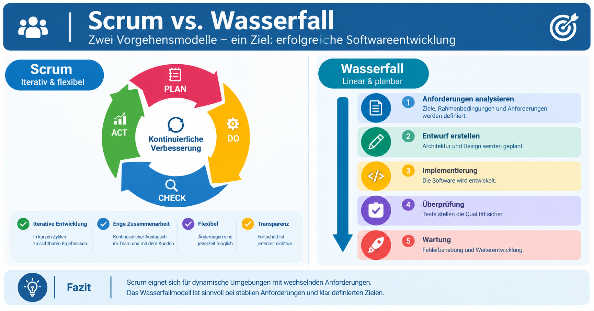
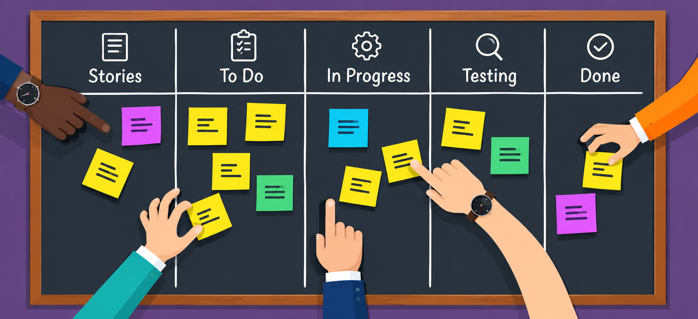

|                      |                           |                               |
| -------------------- | ------------------------- | ----------------------------- |
| **HF Systemtechnik** | **Softwareentwicklung A** |  |

- [1. Agile Softwareentwicklung \& Systems Engineering](#1-agile-softwareentwicklung--systems-engineering)
  - [1.1. Lernziele](#11-lernziele)
  - [1.2. Grenzen des klassischen Phasenmodells](#12-grenzen-des-klassischen-phasenmodells)
    - [1.2.1. Einstieg – Problemorientierung](#121-einstieg--problemorientierung)
    - [1.2.2. Klassische Projektabwicklung](#122-klassische-projektabwicklung)
    - [1.2.3. Ablauf klassischer Projekte](#123-ablauf-klassischer-projekte)
    - [1.2.4. Vorteile](#124-vorteile)
    - [1.2.5. Nachteil/Probleme](#125-nachteilprobleme)
    - [1.2.6. Fazit](#126-fazit)
  - [1.3. Grundhaltung agiler Softwareentwicklung](#13-grundhaltung-agiler-softwareentwicklung)
  - [1.4. Vorgehensmodelle im Überblick](#14-vorgehensmodelle-im-überblick)
    - [1.4.1. Scrum im Detail](#141-scrum-im-detail)
    - [1.4.2. Kanban im Detail](#142-kanban-im-detail)
  - [1.5. Klassisch vs. agil – Vergleich und Einsatzkriterien](#15-klassisch-vs-agil--vergleich-und-einsatzkriterien)
    - [1.5.1. Die 4 Werte](#151-die-4-werte)
    - [1.5.2. Die 12 Prinzipien](#152-die-12-prinzipien)
    - [1.5.3. Grundidee](#153-grundidee)
    - [1.5.4. Agile Prinzipien](#154-agile-prinzipien)
  - [1.6. Systems Engineering – der systemische Blick](#16-systems-engineering--der-systemische-blick)
- [2. Übungsaufgaben](#2-übungsaufgaben)
  - [2.1. Agile vs. klassisch begründet wählen](#21-agile-vs-klassisch-begründet-wählen)
  - [2.2. Papierflugzeug-Projekt](#22-papierflugzeug-projekt)

---

</br>

# 1. Agile Softwareentwicklung & Systems Engineering

## 1.1. Lernziele

Nach diesem Kapitel können Sie:

- [ ] die Grenzen des klassischen Wasserfallmodells erklären
- [ ] die Grundhaltung agiler Softwareentwicklung beschreiben
- [ ] Scrum und Kanban in ihren Grundzügen erklären und voneinander abgrenzen
- [ ] klassisches und agiles Vorgehen anhand konkreter Kriterien vergleichen und situativ begründet auswählen
- [ ] den systemischen Blick (Systems Engineering) auf Softwareentwicklung erklären und auf ein eigenes Beispiel übertragen

## 1.2. Grenzen des klassischen Phasenmodells

Das in früherem Kapitel vorgestellte Wasserfallmodell geht davon aus, dass Anforderungen zu Beginn eines Projekts bereits **vollständig und stabil** bekannt sind. In der Praxis trifft dies selten zu:

- Auftraggeber/-innen erkennen ihre eigenen Bedürfnisse oft erst, wenn sie ein erstes Ergebnis sehen ("Das ist zwar genau das, was ich gesagt habe – aber nicht das, was ich eigentlich brauche.")
- Rahmenbedingungen (Markt, Technologie, gesetzliche Vorgaben) ändern sich während der Projektlaufzeit
- Bei langer Entwicklungszeit ohne Zwischenergebnisse wird ein Fehlschlag erst sehr spät sichtbar

Diese Erkenntnis führte zur Entwicklung **agiler** Vorgehensmodelle als Gegenentwurf zum starren, linearen Wasserfallmodell.



### 1.2.1. Einstieg – Problemorientierung

Ein Unternehmen entwickelt eine Software für ein Smart-Home-System. Nach 12 Monaten Entwicklung wird das System dem Kunden präsentiert.

> **Der Kunde sagt: „So habe ich mir das nicht vorgestellt.“**

- Was könnte schiefgelaufen sein?
- Wer ist verantwortlich?
- Wann hätte man das Problem erkennen können?

> **Antworten sammeln (Tafel / Whiteboard).**

### 1.2.2. Klassische Projektabwicklung

- Ein typisches klassisches Modell ist das Wasserfallmodell.
- Das Wasserfallmodell folgt einem linearen Ablauf:

```console
Anforderungen → Design → Implementierung → Test → Betrieb
```

Ein Beispiel ist das bekannte Modell von [Winston W. Royce](https://commons.wikimedia.org/wiki/Category%3AWinston_W._Royce)

### 1.2.3. Ablauf klassischer Projekte

1. Anforderungen
2. Design
3. Implementierung
4. Test
5. Auslieferung



### 1.2.4. Vorteile

- klare Planung
- strukturierte Dokumentation
- gut für stabile Anforderungen

### 1.2.5. Nachteil/Probleme

- Änderungen schwierig
- Feedback kommt spät
- Risiko steigt mit Projektdauer
- Kunde sieht Produkt erst am Ende

### 1.2.6. Fazit

Das Wasserfall-Modell funktioniert gut, wenn Anforderungen **vollständig und stabil** sind – in der Praxis selten erfüllt.

> **Probleme des Wasserfallmodells**
>
> - Änderungen sind teuer, je später sie im Projekt auftreten
> - Kundenrückmeldung erfolgt erst am Projektende
> - Fehler in Anforderungen werden spät erkannt – wenn sie am teuersten zu beheben sind
> - „Big Bang"-Lieferung: Alles oder nichts am Projektende
> - Laut Standish CHAOS Report: **66 % aller Projekte** zu spät oder zu teuer – 19 % scheitern ganz

---

## 1.3. Grundhaltung agiler Softwareentwicklung

Agile Entwicklung entstand als Gegenbewegung zu starren Prozessen.



Ein wichtiger Meilenstein ist das [Agile Manifesto](https://de.wikipedia.org/wiki/Agile_Softwareentwicklung)

Agile Methoden basieren auf einer gemeinsamen Grundhaltung, die Anfang der 2000er-Jahre von einer Gruppe von Softwareentwicklern in einem gemeinsamen Manifest formuliert wurde. Zusammengefasst stehen dabei folgende Werte im Zentrum:

| **Mehr Gewicht auf …**                | **… als auf**                 |
| ------------------------------------- | ----------------------------- |
| Individuen und direkte Zusammenarbeit | starre Prozesse und Werkzeuge |
| funktionierende Software              | umfassende Dokumentation      |
| Zusammenarbeit mit dem/der Kunden/-in | Vertragsverhandlungen         |
| Reagieren auf Veränderung             | strikte Planverfolgung        |

> **Wichtig für das Verständnis:** Agile Werte stellen **keine** absolute Ablehnung von Dokumentation, Verträgen oder Planung dar – sie setzen lediglich eine andere **Priorität**, wenn ein Konflikt zwischen beiden Seiten entsteht. Auch agile Projekte benötigen Spezifikationen (Kapitel 3) und Entwurfswerkzeuge (Kapitel 4–6) – nur werden diese iterativ statt einmalig zu Beginn erstellt.

**Kernidee:** Iteratives, kleinschrittiges Vorgehen mit regelmässigem Feedback statt eines einzigen grossen "Big-Bang"-Release am Projektende.

---

## 1.4. Vorgehensmodelle im Überblick

| **Vorgehensmodell**        | **Kernidee**                                                                                                        |
| -------------------------- | ------------------------------------------------------------------------------------------------------------------- |
| **Wasserfall** (klassisch) | Lineare Abfolge der Phasen, Anforderungen zu Beginn fixiert                                                         |
| **Prototyping**            | Frühzeitig ein lauffähiges, vereinfachtes Modell erstellen, um Anforderungen mit dem/der Auftraggeber/-in zu klären |
| **Scrum**                  | Feste, kurze Zeitzyklen (Sprints) mit definierten Rollen und Ritualen                                               |
| **Kanban**                 | Kontinuierlicher Arbeitsfluss über ein Board, ohne feste Sprintlänge                                                |

### 1.4.1. Scrum im Detail

| **Element**              | **Beschreibung**                                                                                    |
| ------------------------ | --------------------------------------------------------------------------------------------------- |
| **Sprint**               | Fester Zeitraum (typ. 1–4 Wochen), an dessen Ende ein lauffähiges Teilergebnis (Inkrement) vorliegt |
| **Product Owner**        | Verantwortlich für die Priorisierung der Anforderungen (Product Backlog)                            |
| **Scrum Master**         | Sorgt für die Einhaltung des Scrum-Prozesses, beseitigt Hindernisse                                 |
| **Entwicklungsteam**     | Setzt die priorisierten Anforderungen im Sprint um                                                  |
| **Daily Scrum**          | Tägliches, kurzes Abstimmungstreffen (typ. 15 Min.)                                                 |
| **Sprint Review**        | Präsentation des Sprintergebnisses an Stakeholder                                                   |
| **Sprint Retrospektive** | Rückblick des Teams auf die eigene Zusammenarbeit, Verbesserungsvorschläge                          |

### 1.4.2. Kanban im Detail

Kanban visualisiert den Arbeitsfluss über ein **Board** mit Spalten (z. B. "Offen" – "In Arbeit" – "Erledigt") und begrenzt bewusst die Anzahl gleichzeitig in Bearbeitung befindlicher Aufgaben (**WIP-Limit**, Work in Progress), um Engpässe sichtbar zu machen und Multitasking zu reduzieren. Im Gegensatz zu Scrum kennt Kanban **keine festen Sprints** – Aufgaben fliessen kontinuierlich durch das Board.



---

## 1.5. Klassisch vs. agil – Vergleich und Einsatzkriterien

| **Kriterium**                         | **Wasserfall eher geeignet, wenn …**                                                 | **Agil eher geeignet, wenn …**                      |
| ------------------------------------- | ------------------------------------------------------------------------------------ | --------------------------------------------------- |
| Änderungshäufigkeit der Anforderungen | Anforderungen stabil, gut bekannt                                                    | Anforderungen unklar oder erwartbar veränderlich    |
| Projektgrösse/-risiko                 | Klein, überschaubar, vertraglich fixiert                                             | Grösser, mit Unsicherheiten behaftet                |
| Kundennähe während der Entwicklung    | Kunde nicht laufend verfügbar                                                        | Regelmässiger Austausch mit Kunde/Anwendern möglich |
| Regulatorische Vorgaben               | Vorgeschriebene, dokumentierte Freigabeschritte (z. B. sicherheitskritische Systeme) | Weniger regulatorisch geprägtes Umfeld              |

### 1.5.1. Die 4 Werte

| **Linke Seite *(mehr Wert)***     |       | **Rechte Seite *(hat Wert)*** |
| --------------------------------- | :---: | ----------------------------- |
| **Individuen und Interaktionen**  | über  | Prozesse und Werkzeuge        |
| **Funktionierende Software**      | über  | Umfassende Dokumentation      |
| **Zusammenarbeit mit dem Kunden** | über  | Vertragsverhandlungen         |
| **Reagieren auf Veränderung**     | über  | Das Befolgen eines Plans      |

> Beide Seiten haben Wert – die linke Seite hat **mehr** Wert.

### 1.5.2. Die 12 Prinzipien

1. Kundenzufriedenheit durch frühzeitige und kontinuierliche Lieferung wertvoller Software
2. Veränderungen in Anforderungen willkommen heissen – auch spät im Prozess
3. Funktionierende Software häufig liefern – alle paar Wochen oder Monate
4. Fachleute und Entwickler müssen täglich zusammenarbeiten
5. Projekte rund um motivierte Individuen errichten; ihnen Vertrauen schenken
6. Die effizienteste Kommunikation ist das direkte Gespräch von Angesicht zu Angesicht
7. Funktionierende Software ist das wichtigste Fortschrittsmass
8. Agile Prozesse fördern nachhaltige Entwicklung und ein gleichmässiges Tempo
9. Ständige Aufmerksamkeit auf technische Exzellenz und gutes Design
10. Einfachheit – die Kunst, den Umfang nicht getaner Arbeit zu maximieren
11. Die besten Architekturen und Entwürfe entstehen in selbstorganisierenden Teams
12. Das Team reflektiert regelmässig sein Vorgehen und passt es an

### 1.5.3. Grundidee

> **Software wird schrittweise entwickelt.**

**Statt:** 12 Monate entwickeln → dann testen

**macht man:** kleine Iterationen → kontinuierliches Feedback

### 1.5.4. Agile Prinzipien

- kurze Entwicklungszyklen
- frühes Feedback
- Zusammenarbeit mit Kunden
- Anpassung an Änderungen

```bash
Plan
 ↓
Develop
 ↓
Test
 ↓
Feedback
 ↓
Verbesserung
```

> **Dieser Zyklus wiederholt sich mehrmals.**

---

## 1.6. Systems Engineering – der systemische Blick

**Systems Engineering** betrachtet Software nicht isoliert, sondern als **Teil eines Gesamtsystems** aus Mensch, Maschine, Umwelt und weiteren Softwarekomponenten. Änderungen an einer Stelle wirken sich häufig – teils unerwartet – auf andere Systemteile aus.

Zentrale Denkprinzipien:

- **Ganzheitliche Betrachtung:** Nicht nur die Software selbst, sondern ihr Zusammenspiel mit Hardware, Anwendern und Umgebung betrachten
- **Schnittstellen bewusst gestalten:** Die meisten Probleme in vernetzten Systemen entstehen an den Schnittstellen zwischen Teilsystemen, nicht innerhalb eines einzelnen Teilsystems
- **Wechselwirkungen antizipieren:** Vor einer Änderung fragen: "Welche anderen Systemteile beeinflusst das?"

> **Für Systemtechniker/-innen HF besonders relevant:** Dieses Denken ist aus der Automatisierungstechnik bereits vertraut (Zusammenspiel von Sensorik, Aktorik, Steuerung, Prozess) und lässt sich direkt auf Software übertragen – eine Software-Komponente ist letztlich ebenfalls nur ein Teilsystem im Gesamtsystem.

**Beispiel:** Wird in einem Auswertetool das Dateiformat einer Schnittstelle geändert, wirkt sich das nicht nur auf das Tool selbst aus, sondern potenziell auch auf: das liefernde System (Messgerät/Steuerung), andere Tools, die dieselbe Datei nutzen, sowie die Dokumentation und Schulung der Anwender.

---

</br>

# 2. Übungsaufgaben

## 2.1. Agile vs. klassisch begründet wählen

| **Vorgabe**         | **Beschreibung**                                                                            |
| :------------------ | :------------------------------------------------------------------------------------------ |
| **Lernziele**       | Vorgehensmodell anhand konkreter Kriterien begründet auswählen; systemischen Blick anwenden |
| **Sozialform**      | Gruppen à 3–4 Personen                                                                      |
| **Auftrag**         | siehe unten                                                                                 |
| **Zeitbedarf**      | 30 min inkl. Kurzpräsentation                                                               |
| **Lösungselemente** | Begründete Wahl anhand von mind. 3 Kriterien + eine identifizierte Wechselwirkung           |

**Aufgabenstellung:**

Diskutieren Sie ein (reales oder fiktives) Softwareprojekt aus Ihrem Betrieb, z. B. die Ablösung eines bestehenden Auswertetools.

1. Würden Sie eher klassisch (Wasserfall) oder agil (Scrum/Kanban) vorgehen? Begründen Sie anhand von mindestens 3 Kriterien aus Kapitel 9.4.
2. Nennen Sie mindestens eine Wechselwirkung im Sinne des Systems Engineering (Kapitel 9.5), die bei einer Änderung dieses Tools zu beachten wäre.
3. Präsentiert eure Überlegungen in max. 3 Minuten der Klasse.

---

## 2.2. Papierflugzeug-Projekt

| **Vorgabe**             | **Beschreibung**                                                            |
| :---------------------- | :-------------------------------------------------------------------------- |
| **Lernziele**           | Studierende sollen praktisch erleben, warum agile Entwicklung Vorteile hat. |
| **Sozialform**          | Gruppenarbeit                                                               |
| **Auftrag**             | siehe unten                                                                 |
| **Hilfsmittel**         | A4 Papier                                                                   |
| **Erwartete Resultate** |                                                                             |
| **Zeitbedarf**          | 15 min                                                                      |
| **Lösungselemente**     | Papierflugzeug                                                              |

**Auftrag:**
Die Gruppe sollen ein Papierflugzeug entwickeln, das möglichst weit fliegt.

**Variante 1 – Klassisches Projekt:**

Ablauf:

1. 5 Minuten Planung
2. Flugzeug bauen
3. 1 Testflug

> **Regel:**
> Während der Planung darf nicht getestet werden.

**Variante 2 – Agile Entwicklung:**

Ablauf (3 Iterationen):

- Iteration:
  1. bauen
  2. testen
  3. verbessern

Zeit pro Iteration: 2 Minuten

**Fragen:**

- Welche Methode war erfolgreicher?
- Welche Methode machte mehr Spass?
- Welche Methode lernte schneller?
