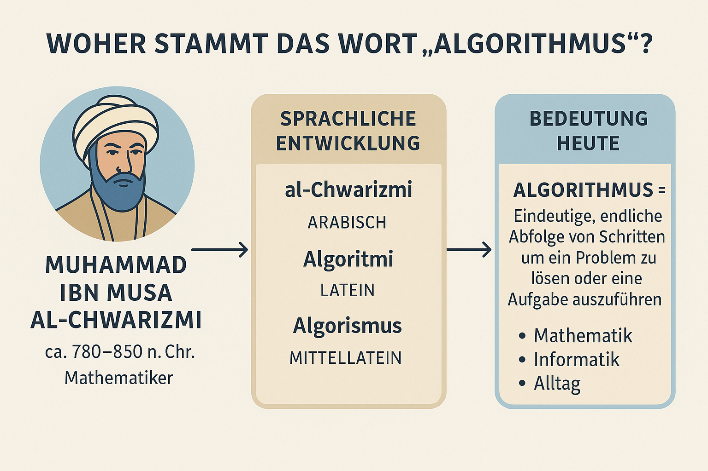
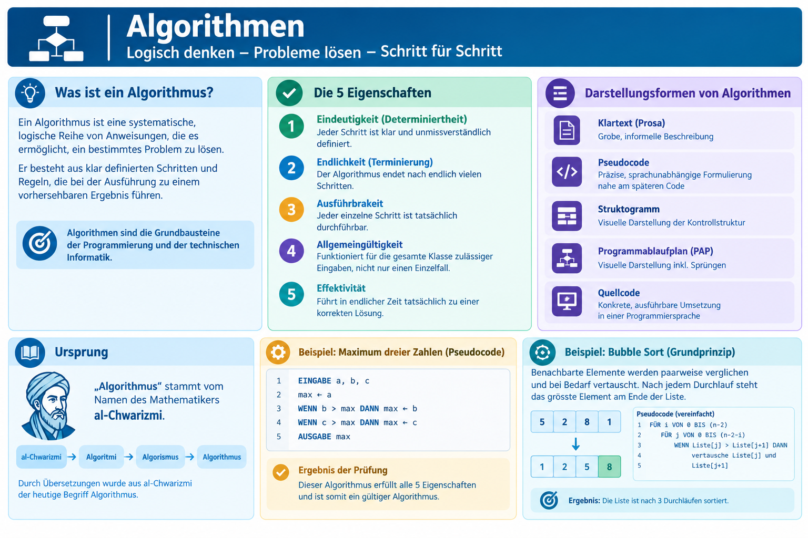
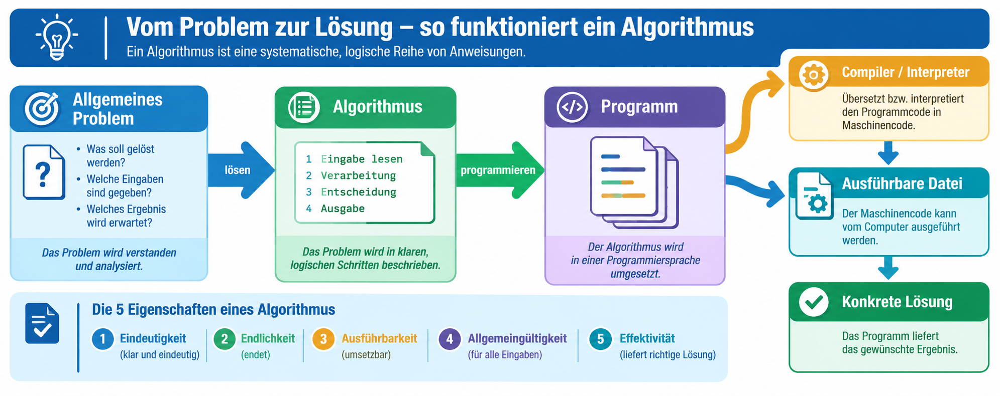

|                      |                           |                               |
| -------------------- | ------------------------- | ----------------------------- |
| **HF Systemtechnik** | **Softwareentwicklung A** |  |

- [1. Algorithmen](#1-algorithmen)
  - [1.1. Lernziele](#11-lernziele)
  - [1.2. Ursprung](#12-ursprung)
  - [1.3. Definition und Eigenschaften](#13-definition-und-eigenschaften)
  - [1.4. Darstellungsformen von Algorithmen](#14-darstellungsformen-von-algorithmen)
  - [1.5. Ablauf vom Problem zur Lösung](#15-ablauf-vom-problem-zur-lösung)
  - [1.6. Beispiel: Maximum dreier Zahlen (Pseudocode)](#16-beispiel-maximum-dreier-zahlen-pseudocode)
  - [1.7. Beispiel: Zähneputzen (menschlicher Algorithmus)](#17-beispiel-zähneputzen-menschlicher-algorithmus)
  - [1.8. Beispiel: Sortieralgorithmus Bubble Sort](#18-beispiel-sortieralgorithmus-bubble-sort)
  - [1.9. Aufwand von Algorithmen – eine erste Intuition](#19-aufwand-von-algorithmen--eine-erste-intuition)
- [2. Übungsaufgaben](#2-übungsaufgaben)
  - [2.1. Zahlenraten (einfach)](#21-zahlenraten-einfach)
  - [2.2. Bubble Sort von Hand durchführen](#22-bubble-sort-von-hand-durchführen)
  - [2.3. Messwert-Überwachung pro Schicht (fortgeschritten)](#23-messwert-überwachung-pro-schicht-fortgeschritten)
  - [2.4. Primzahlen bis n (fortgeschritten)](#24-primzahlen-bis-n-fortgeschritten)

# 1. Algorithmen

## 1.1. Lernziele

Nach diesem Kapitel können Sie:

- [ ] die Definition und die 5 Eigenschaften eines Algorithmus erklären
- [ ] Algorithmen in Pseudocode formulieren
- [ ] einen einfachen Algorithmus anhand seiner Eigenschaften prüfen
- [ ] das Grundprinzip eines einfachen Sortieralgorithmus (Bubble Sort) nachvollziehen und von Hand durchführen
- [ ] intuitiv einschätzen, wie sich der Aufwand eines Algorithmus mit der Datenmenge verändert

## 1.2. Ursprung

**„Algorithmus“** stammt vom Namen des Mathematikers **al-Chwarizmi**.
Durch Übersetzungen wurde aus **al-Chwarizmi → Algoritmi → Algorismus → Algorithmus**.



## 1.3. Definition und Eigenschaften

**Definition:**

Ein Algorithmus ist eine **systematische, logische Reihe von Anweisungen**, die es ermöglicht, ein bestimmtes Problem zu lösen. Er besteht aus klar definierten Schritten und Regeln, die bei der Ausführung zu einem vorhersehbaren Ergebnis führen. **Algorithmen** sind die Grundbausteine der Programmierung und der technischen Informatik, da sie die Basis für die Entwicklung effizienter und funktionaler Software bieten



Ein Algorithmus muss folgende **5 Eigenschaften** erfüllen, um als solcher zu gelten:

| **Eigenschaft**                      | **Bedeutung**                                                                       |
| ------------------------------------ | ----------------------------------------------------------------------------------- |
| **Eindeutigkeit (Determiniertheit)** | Jeder Schritt ist klar und unmissverständlich definiert                             |
| **Endlichkeit (Terminierung)**       | Der Algorithmus endet nach endlich vielen Schritten                                 |
| **Ausführbarkeit**                   | Jeder einzelne Schritt ist tatsächlich durchführbar                                 |
| **Allgemeingültigkeit**              | Funktioniert für die gesamte Klasse zulässiger Eingaben, nicht nur einen Einzelfall |
| **Effektivität**                     | Führt in endlicher Zeit tatsächlich zu einer korrekten Lösung                       |

> **Prüfungsrelevant:** In Prüfungen wird häufig verlangt, einen gegebenen Algorithmus anhand dieser 5 Eigenschaften zu **beurteilen** – z.B. "Ist dieser Ablauf ein gültiger Algorithmus? Begründen Sie." Ein häufiger Fehler ist ein Algorithmus, der bei bestimmten Eingaben nicht terminiert (z. B. eine Endlosschleife ohne gültige Abbruchbedingung).

## 1.4. Darstellungsformen von Algorithmen

Ein Algorithmus kann auf unterschiedliche Weise dargestellt werden – die in diesem Modul behandelten Werkzeuge sind alle mögliche Darstellungsformen desselben zugrundeliegenden Algorithmus:

| **Darstellungsform**     | **Geeignet für**                                              |
| ------------------------ | ------------------------------------------------------------- |
| Klartext (Prosa)         | Grobe, informelle Beschreibung                                |
| **Pseudocode**           | Präzise, sprachunabhängige Formulierung nahe am späteren Code |
| Struktogramm             | Visuelle Darstellung der Kontrollstruktur                     |
| Programmablaufplan (PAP) | Visuelle Darstellung inkl. Sprüngen                           |
| Quellcode                | Konkrete, ausführbare Umsetzung in einer Programmiersprache   |

## 1.5. Ablauf vom Problem zur Lösung



## 1.6. Beispiel: Maximum dreier Zahlen (Pseudocode)

```bash
EINGABE a, b, c
max ← a
WENN b > max DANN max ← b
WENN c > max DANN max ← c
AUSGABE max
```

**Prüfung anhand der 5 Eigenschaften:**

- Eindeutigkeit: Jeder Schritt ist klar (Zuweisung, Vergleich) ✓
- Endlichkeit: Genau 2 Vergleiche, dann Ende ✓
- Ausführbarkeit: Vergleich und Zuweisung sind elementare, ausführbare Operationen ✓
- Allgemeingültigkeit: Funktioniert für beliebige Zahlen a, b, c (auch negative, auch gleiche Werte) ✓
- Effektivität: Liefert stets die korrekte grösste Zahl ✓

## 1.7. Beispiel: Zähneputzen (menschlicher Algorithmus)

**Problem**: Zähne putzen

**Algorithmus**:

1. Zahnbürste nehmen
2. Zahnpasta auftragen
3. Wasser auf Zahnbürste geben
4. Zähne 2 Minuten lang in kreisenden Bewegungen putzen
5. Mund ausspülen
6. Zahnbürste auswaschen

## 1.8. Beispiel: Sortieralgorithmus Bubble Sort

**Grundprinzip:** Benachbarte Elemente werden paarweise verglichen und bei Bedarf vertauscht. Nach jedem vollständigen Durchlauf "steigt" das jeweils grösste noch unsortierte Element wie eine Luftblase ("bubble") an sein endgültiges Ende der Liste.

**Pseudocode:**

```bash
FÜR i VON 0 BIS (n-2)
  FÜR j VON 0 BIS (n-2-i)
    WENN Liste[j] > Liste[j+1] DANN
      vertausche Liste[j] und Liste[j+1]
```

**Schritt-für-Schritt-Beispiel mit der Liste `[5, 2, 8, 1]`:**

| **Durchlauf** | **Vergleich** | **Aktion**   | **Zustand der Liste** |
| ------------- | ------------- | ------------ | --------------------- |
| 1             | 5 vs 2        | vertauschen  | `[2, 5, 8, 1]`        |
| 1             | 5 vs 8        | keine Aktion | `[2, 5, 8, 1]`        |
| 1             | 8 vs 1        | vertauschen  | `[2, 5, 1, 8]`        |
| 2             | 2 vs 5        | keine Aktion | `[2, 5, 1, 8]`        |
| 2             | 5 vs 1        | vertauschen  | `[2, 1, 5, 8]`        |
| 3             | 2 vs 1        | vertauschen  | `[1, 2, 5, 8]`        |

Ergebnis nach 3 Durchläufen: `[1, 2, 5, 8]` – vollständig sortiert.

> Der Algorithmus ist zwar für grosse Datenmengen ineffizient, eignet sich aber hervorragend zum Erlernen des Grundprinzips "Vergleichen und Vertauschen", da er sich von Hand leicht nachvollziehen lässt.

## 1.9. Aufwand von Algorithmen – eine erste Intuition

Nicht jeder Algorithmus, der ein Problem korrekt löst, ist gleich **effizient**. Bereits mit einfachen Mitteln lässt sich abschätzen, wie der Aufwand mit wachsender Datenmenge zunimmt:

| Anzahl Elemente n | Anzahl Vergleiche bei Bubble Sort (ungefähr n²) |
| ----------------- | ----------------------------------------------- |
| 10                | ca. 100                                         |
| 100               | ca. 10'000                                      |
| 1'000             | ca. 1'000'000                                   |

**Beobachtung:** Verzehnfacht sich die Datenmenge, verhundertfacht sich (nicht nur verzehnfacht sich!) der Aufwand bei Bubble Sort. Diese Beobachtung – dass der Aufwand **überproportional** zur Datenmenge wächst – ist der intuitive Kern dessen, was in der Informatik als **Komplexität eines Algorithmus** bezeichnet wird. Eine formale Betrachtung (Landau-/O-Notation) ist nicht Gegenstand dieses Moduls, wird aber in Softwareentwicklung B vertieft.

> **Praxisrelevanz für Systemtechniker:** Schon das blosse Bewusstsein, dass "ein bisschen mehr Daten" nicht zwangsläufig "ein bisschen mehr Rechenzeit" bedeutet, hilft, Performance-Probleme in eigenen Tools frühzeitig zu antizipieren.

---

</br>

# 2. Übungsaufgaben

## 2.1. Zahlenraten (einfach)

| **Vorgabe**         | **Beschreibung**                                                                               |
| :------------------ | :--------------------------------------------------------------------------------------------- |
| **Lernziele**       | Einen Algorithmus mit Schleife und Verzweigung formulieren, prüfen und in Flowgorithm umsetzen |
| **Sozialform**      | Einzelarbeit                                                                                   |
| **Hilfsmittel**     | Flowgorithm, Kapitel oben                                                                      |
| **Auftrag**         | siehe unten                                                                                    |
| **Zeitbedarf**      | 30 min                                                                                         |
| **Lösungselemente** | Pseudocode, Prüfung der 5 Eigenschaften, lauffähiges Flowgorithm-Programm, 3 Testläufe         |

**Aufgabenstellung:**

Programmieren Sie ein kleines Ratespiel: Das Programm denkt sich eine ganze Zufallszahl zwischen 1 und 100 aus. Sie versuchen, diese Zahl zu erraten.

- Nach jedem Tipp meldet das Programm **"Zu klein!"**, **"Zu gross!"** oder **"Richtig!"**.
- Das Programm fragt so lange nach einem neuen Tipp, bis die Zahl erraten ist.
- Am Schluss gibt das Programm die **Anzahl der benötigten Versuche** aus.

1. Formulieren Sie den Algorithmus in **Pseudocode** (siehe Kapitel 1.6).
2. Prüfen Sie Ihren Algorithmus schriftlich anhand der **5 Eigenschaften** (Kapitel 1.3). Bei welcher Eigenschaft sind Sie sich nicht ganz sicher? Begründen Sie.
3. Setzen Sie den Algorithmus in **Flowgorithm** um.
4. Testen Sie Ihr Programm mit mindestens **3 Testläufen** und halten Sie Eingaben und Ergebnisse in einer kleinen Tabelle fest.

> **Hinweise zu Flowgorithm:**
>
> - Eine Zufallszahl erzeugen Sie mit `Random(100)`. Achtung: Diese Funktion liefert Zahlen von **0 bis 99** – passen Sie das Ergebnis an, damit Sie auf 1 bis 100 kommen.
> - Für reproduzierbare Tests setzen Sie die Geheimzahl vorübergehend auf einen festen Wert (z. B. `42`) statt auf eine Zufallszahl.
> - Überlegen Sie, wie die Schleife beim allerersten Durchlauf überhaupt startet, bevor der erste Tipp eingegeben wurde.

**Zusatz (optional):**

- Mit welcher Strategie finden Sie die Zahl garantiert in höchstens 7 Versuchen? Begründen Sie, warum es nie mehr als 7 sind.
- Begrenzen Sie die Versuche auf 7: Nach dem 7. falschen Tipp beendet das Programm das Spiel und verrät die gesuchte Zahl.

---

## 2.2. Bubble Sort von Hand durchführen

| **Vorgabe**    | **Beschreibung**                               |
| :------------- | :--------------------------------------------- |
| **Lernziele**  | Bubble Sort Schritt für Schritt nachvollziehen |
| **Sozialform** | Partnerarbeit                                  |
| **Zeitbedarf** | 20 min                                         |

**Aufgabenstellung:**

Führen Sie Bubble Sort von Hand für die Liste `[9, 3, 7, 1, 5]` durch. Dokumentieren Sie jeden Vergleich und jede Vertauschung analog zur Tabelle oben (Sortieralgorithmus Bubble Sort), bis die Liste vollständig sortiert ist.

---

## 2.3. Messwert-Überwachung pro Schicht (fortgeschritten)

| **Vorgabe**         | **Beschreibung**                                                                                                        |
| :------------------ | :---------------------------------------------------------------------------------------------------------------------- |
| **Lernziele**       | Verschachtelte Zählschleifen und mehrstufige Verzweigungen umsetzen; Zähler gezielt zurücksetzen; ein Maximum bestimmen |
| **Sozialform**      | Partnerarbeit                                                                                                           |
| **Hilfsmittel**     | Flowgorithm, Kapitel oben                                                                                               |
| **Auftrag**         | siehe unten                                                                                                             |
| **Zeitbedarf**      | 60 min                                                                                                                  |
| **Lösungselemente** | Pseudocode, Prüfung der 5 Eigenschaften, lauffähiges Flowgorithm-Programm, Testprotokoll, Aufwandsüberlegung            |

**Aufgabenstellung:**

Eine Produktionsmaschine läuft in mehreren Schichten. In jeder Schicht werden mehrere Temperaturmesswerte (in °C) erfasst. Sie programmieren eine Auswertung dieser Messwerte.

- Das Programm fragt zuerst die **Anzahl der Schichten** und die **Anzahl der Messungen pro Schicht** ab (jeweils mindestens 1).
- Danach werden die Messwerte schichtweise eingelesen. Jeder Messwert wird sofort bewertet und die Bewertung ausgegeben:
  - Wert **grösser als 90** → "Alarm"
  - Wert **grösser als 70** (bis und mit 90) → "Warnung"
  - sonst → "OK"
- Nach jeder Schicht gibt das Programm die **Anzahl Alarme** und die **Anzahl Warnungen dieser Schicht** aus.
- Am Schluss nennt das Programm die **Schicht mit den meisten Alarmen** (inkl. Anzahl). Bei Gleichstand gilt die frühere Schicht. Traten gar keine Alarme auf, meldet das Programm "Keine Alarme aufgetreten."

1. Formulieren Sie den Algorithmus in **Pseudocode**.
2. Prüfen Sie Ihren Algorithmus anhand der **5 Eigenschaften** (Kapitel 1.3). Begründen Sie insbesondere, warum **beide** Schleifen garantiert enden (Endlichkeit). Wodurch unterscheidet sich das von der Aufgabe 2.1 (Zahlenraten)?
3. Setzen Sie den Algorithmus in **Flowgorithm** um.
4. Erstellen Sie ein **Testprotokoll** mit mindestens 5 Testfällen. Jeder Testfall soll eine andere Situation abdecken: Normalfall mit mehreren Schichten, Gleichstand bei den Alarmen, keine Alarme, die Grenzwerte (70, 71, 90, 91) und eine minimale Eingabe (1 Schicht, 1 Messung). Rechnen Sie das erwartete Ergebnis jeweils zuerst von Hand aus.
5. **Aufwand (Kapitel 1.9):** Wie viele Messwerte müssen bei 3 Schichten mit je 8 Messungen eingegeben werden? Wie verändert sich diese Anzahl, wenn (a) nur die Anzahl der Schichten verdoppelt wird, (b) beide Zahlen verdoppelt werden? Vergleichen Sie mit der Beobachtung bei den Primzahlen (Aufgabe 2.2).

> **Hinweise:**
>
> - Überlegen Sie, welche Variablen für **jede neue Schicht** wieder auf ihren Startwert gesetzt werden müssen.
> - Die Reihenfolge der Prüfungen ist wichtig: Ein Wert von 95 ist grösser als 70 **und** grösser als 90. Welche Bewertung soll gelten?
> - Die "Schicht mit den meisten Alarmen" bestimmen Sie nach demselben Prinzip wie das Maximum dreier Zahlen (Kapitel 1.6): Merken Sie sich den bisher grössten Wert und die zugehörige Schicht.

**Zusatz (optional):**

- Das Programm soll zusätzlich den **höchsten Messwert** insgesamt ausgeben, samt Schicht und Nummer der Messung (bei mehreren gleichen Werten gilt der erste).
- Ungültige Messwerte (kleiner als 0 oder grösser als 150) werden abgelehnt und erneut abgefragt.

---

## 2.4. Primzahlen bis n (fortgeschritten)

| **Vorgabe**         | **Beschreibung**                                                                                              |
| :------------------ | :------------------------------------------------------------------------------------------------------------ |
| **Lernziele**       | Verschachtelte Schleifen und Verzweigungen mit Merker-Variable umsetzen; den Aufwand eines Algorithmus messen |
| **Sozialform**      | Partnerarbeit                                                                                                 |
| **Hilfsmittel**     | Flowgorithm, Kapitel oben                                                                                     |
| **Auftrag**         | siehe unten                                                                                                   |
| **Zeitbedarf**      | 60 min                                                                                                        |
| **Lösungselemente** | Pseudocode, Prüfung der 5 Eigenschaften, lauffähiges Flowgorithm-Programm, Testprotokoll, Aufwandsmessung     |

**Aufgabenstellung:**

Programmieren Sie ein Programm, das alle **Primzahlen von 2 bis zu einer eingegebenen Obergrenze n** ausgibt.

- Das Programm liest eine ganze Zahl `n` (n ≥ 2) ein.
- Es gibt jede gefundene Primzahl auf einer eigenen Zeile aus.
- Am Schluss gibt es die **Anzahl der gefundenen Primzahlen** sowie die **Anzahl der durchgeführten Teilbarkeitsprüfungen** aus (= wie oft insgesamt geprüft wurde, ob eine Zahl durch einen Teiler ohne Rest teilbar ist).

Eine Primzahl ist eine ganze Zahl grösser als 1, die nur durch 1 und durch sich selbst teilbar ist (z. B. 2, 3, 5, 7, 11).

**Vorgehen:** Prüfen Sie jede Zahl von 2 bis n der Reihe nach auf Teiler zwischen 2 und (Zahl − 1). Sobald ein Teiler gefunden wurde, sind für diese Zahl keine weiteren Prüfungen mehr nötig.

1. Formulieren Sie den Algorithmus in **Pseudocode**.
2. Prüfen Sie Ihren Algorithmus anhand der **5 Eigenschaften** (Kapitel 1.3). Begründen Sie insbesondere, warum **beide** Schleifen garantiert enden (Endlichkeit).
3. Setzen Sie den Algorithmus in **Flowgorithm** um.
4. Rechnen Sie das erwartete Ergebnis für **n = 2, n = 10 und n = 30** zuerst von Hand aus und vergleichen Sie danach mit Ihrem Programm. Halten Sie die Ergebnisse in einem Testprotokoll fest.
5. **Aufwand (Kapitel 1.9):** Starten Sie das Programm mit **n = 10, n = 100 und n = 1000** und notieren Sie jeweils die Anzahl der Teilbarkeitsprüfungen. Wie verändert sich der Aufwand, wenn n verzehnfacht wird? Vergleichen Sie mit der Beobachtung bei Bubble Sort.

> **Hinweise:**
>
> - Mit dem Operator `mod` erhalten Sie den Rest einer Division (`zahl mod teiler`). Ist der Rest 0, ist die Zahl durch den Teiler teilbar.
> - Für das Merken "Teiler schon gefunden?" eignet sich eine Variable vom Typ `Boolean`.
> - Überlegen Sie genau, an welcher Stelle Ihres Programms Variablen auf ihren Startwert gesetzt werden müssen – insbesondere, wenn die nächste Zahl geprüft wird.
> - Bei n = 1000 kann die Ausführung einige Sekunden dauern. Stellen Sie in Flowgorithm die Ausführungsgeschwindigkeit auf Maximum.

**Zusatz (optional):**

Es genügt, Teiler zu prüfen, deren Quadrat nicht grösser als die Zahl ist (`teiler * teiler <= zahl`). Passen Sie Ihr Programm an und vergleichen Sie die Anzahl der Prüfungen für n = 1000 mit der ersten Version. Bleiben die gefundenen Primzahlen gleich?

---
