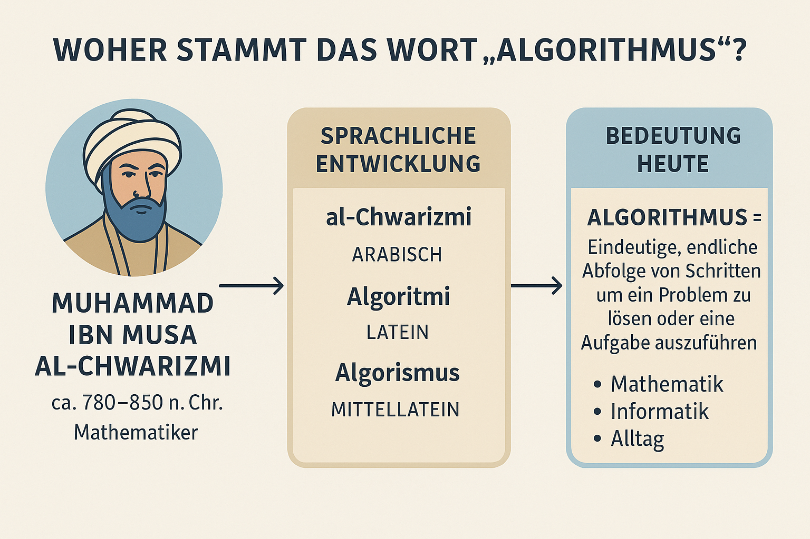
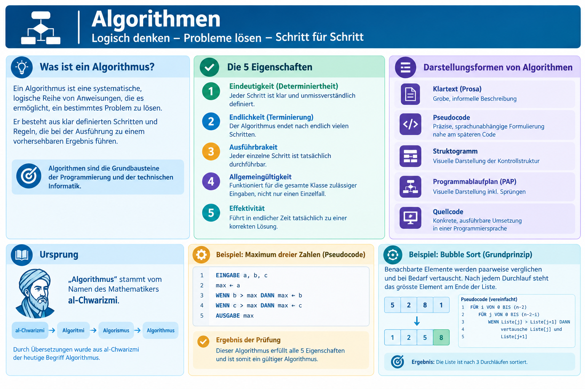
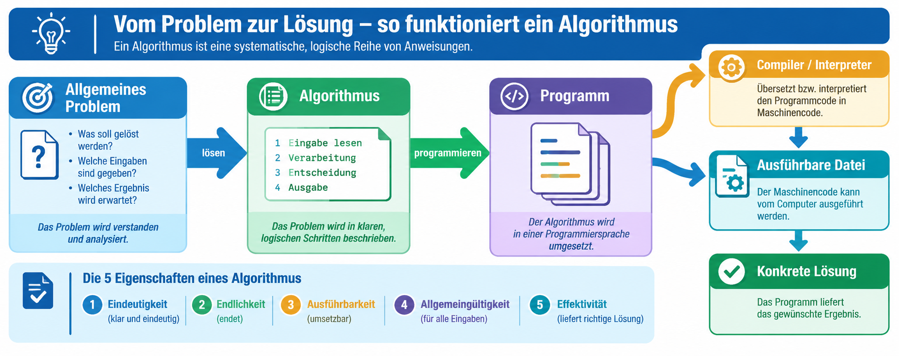

|                      |                           |                               |
| -------------------- | ------------------------- | ----------------------------- |
| **HF Systemtechnik** | **Softwareentwicklung A** |  |

- [1. Algorithmen](#1-algorithmen)
  - [1.1. Lernziele](#11-lernziele)
  - [1.2. Ursprung](#12-ursprung)
  - [1.3. Definition und Eigenschaften](#13-definition-und-eigenschaften)
  - [1.4. Darstellungsformen von Algorithmen](#14-darstellungsformen-von-algorithmen)
  - [1.5. Ablauf vom Problem zur Lösung](#15-ablauf-vom-problem-zur-lösung)
  - [1.6. Beispiel: Maximum dreier Zahlen (Pseudocode)](#16-beispiel-maximum-dreier-zahlen-pseudocode)
  - [1.7. Beispiel: Zähneputzen (menschlicher Algorithmus)](#17-beispiel-zähneputzen-menschlicher-algorithmus)
  - [1.8. Beispiel: Sortieralgorithmus Bubble Sort](#18-beispiel-sortieralgorithmus-bubble-sort)
  - [1.9. Aufwand von Algorithmen – eine erste Intuition](#19-aufwand-von-algorithmen--eine-erste-intuition)
- [2. Übungsaufgaben](#2-übungsaufgaben)
  - [2.1. Algorithmus in Pseudocode formulieren und prüfen](#21-algorithmus-in-pseudocode-formulieren-und-prüfen)
  - [2.2. Bubble Sort von Hand durchführen](#22-bubble-sort-von-hand-durchführen)

# 1. Algorithmen

## 1.1. Lernziele

Nach diesem Kapitel können Sie:

- [ ] die Definition und die 5 Eigenschaften eines Algorithmus erklären
- [ ] Algorithmen in Pseudocode formulieren
- [ ] einen einfachen Algorithmus anhand seiner Eigenschaften prüfen
- [ ] das Grundprinzip eines einfachen Sortieralgorithmus (Bubble Sort) nachvollziehen und von Hand durchführen
- [ ] intuitiv einschätzen, wie sich der Aufwand eines Algorithmus mit der Datenmenge verändert

## 1.2. Ursprung

**„Algorithmus“** stammt vom Namen des Mathematikers **al-Chwarizmi**.
Durch Übersetzungen wurde aus **al-Chwarizmi → Algoritmi → Algorismus → Algorithmus**.



## 1.3. Definition und Eigenschaften

**Definition:**

Ein Algorithmus ist eine **systematische, logische Reihe von Anweisungen**, die es ermöglicht, ein bestimmtes Problem zu lösen. Er besteht aus klar definierten Schritten und Regeln, die bei der Ausführung zu einem vorhersehbaren Ergebnis führen. **Algorithmen** sind die Grundbausteine der Programmierung und der technischen Informatik, da sie die Basis für die Entwicklung effizienter und funktionaler Software bieten



Ein Algorithmus muss folgende **5 Eigenschaften** erfüllen, um als solcher zu gelten:

| **Eigenschaft**                      | **Bedeutung**                                                                       |
| ------------------------------------ | ----------------------------------------------------------------------------------- |
| **Eindeutigkeit (Determiniertheit)** | Jeder Schritt ist klar und unmissverständlich definiert                             |
| **Endlichkeit (Terminierung)**       | Der Algorithmus endet nach endlich vielen Schritten                                 |
| **Ausführbarkeit**                   | Jeder einzelne Schritt ist tatsächlich durchführbar                                 |
| **Allgemeingültigkeit**              | Funktioniert für die gesamte Klasse zulässiger Eingaben, nicht nur einen Einzelfall |
| **Effektivität**                     | Führt in endlicher Zeit tatsächlich zu einer korrekten Lösung                       |

> **Prüfungsrelevant:** In Prüfungen wird häufig verlangt, einen gegebenen Algorithmus anhand dieser 5 Eigenschaften zu **beurteilen** – z.B. "Ist dieser Ablauf ein gültiger Algorithmus? Begründen Sie." Ein häufiger Fehler ist ein Algorithmus, der bei bestimmten Eingaben nicht terminiert (z. B. eine Endlosschleife ohne gültige Abbruchbedingung).

## 1.4. Darstellungsformen von Algorithmen

Ein Algorithmus kann auf unterschiedliche Weise dargestellt werden – die in diesem Modul behandelten Werkzeuge sind alle mögliche Darstellungsformen desselben zugrundeliegenden Algorithmus:

| **Darstellungsform**     | **Geeignet für**                                              |
| ------------------------ | ------------------------------------------------------------- |
| Klartext (Prosa)         | Grobe, informelle Beschreibung                                |
| **Pseudocode**           | Präzise, sprachunabhängige Formulierung nahe am späteren Code |
| Struktogramm             | Visuelle Darstellung der Kontrollstruktur                     |
| Programmablaufplan (PAP) | Visuelle Darstellung inkl. Sprüngen                           |
| Quellcode                | Konkrete, ausführbare Umsetzung in einer Programmiersprache   |

## 1.5. Ablauf vom Problem zur Lösung



## 1.6. Beispiel: Maximum dreier Zahlen (Pseudocode)

```bash
EINGABE a, b, c
max ← a
WENN b > max DANN max ← b
WENN c > max DANN max ← c
AUSGABE max
```

**Prüfung anhand der 5 Eigenschaften:**

- Eindeutigkeit: Jeder Schritt ist klar (Zuweisung, Vergleich) ✓
- Endlichkeit: Genau 2 Vergleiche, dann Ende ✓
- Ausführbarkeit: Vergleich und Zuweisung sind elementare, ausführbare Operationen ✓
- Allgemeingültigkeit: Funktioniert für beliebige Zahlen a, b, c (auch negative, auch gleiche Werte) ✓
- Effektivität: Liefert stets die korrekte grösste Zahl ✓

## 1.7. Beispiel: Zähneputzen (menschlicher Algorithmus)

**Problem**: Zähne putzen

**Algorithmus**:

1. Zahnbürste nehmen
2. Zahnpasta auftragen
3. Wasser auf Zahnbürste geben
4. Zähne 2 Minuten lang in kreisenden Bewegungen putzen
5. Mund ausspülen
6. Zahnbürste auswaschen

## 1.8. Beispiel: Sortieralgorithmus Bubble Sort

**Grundprinzip:** Benachbarte Elemente werden paarweise verglichen und bei Bedarf vertauscht. Nach jedem vollständigen Durchlauf "steigt" das jeweils grösste noch unsortierte Element wie eine Luftblase ("bubble") an sein endgültiges Ende der Liste.

**Pseudocode:**

```bash
FÜR i VON 0 BIS (n-2)
  FÜR j VON 0 BIS (n-2-i)
    WENN Liste[j] > Liste[j+1] DANN
      vertausche Liste[j] und Liste[j+1]
```

**Schritt-für-Schritt-Beispiel mit der Liste `[5, 2, 8, 1]`:**

| **Durchlauf** | **Vergleich** | **Aktion**   | **Zustand der Liste** |
| ------------- | ------------- | ------------ | --------------------- |
| 1             | 5 vs 2        | vertauschen  | `[2, 5, 8, 1]`        |
| 1             | 5 vs 8        | keine Aktion | `[2, 5, 8, 1]`        |
| 1             | 8 vs 1        | vertauschen  | `[2, 5, 1, 8]`        |
| 2             | 2 vs 5        | keine Aktion | `[2, 5, 1, 8]`        |
| 2             | 5 vs 1        | vertauschen  | `[2, 1, 5, 8]`        |
| 3             | 2 vs 1        | vertauschen  | `[1, 2, 5, 8]`        |

Ergebnis nach 3 Durchläufen: `[1, 2, 5, 8]` – vollständig sortiert.

> Der Algorithmus ist zwar für grosse Datenmengen ineffizient, eignet sich aber hervorragend zum Erlernen des Grundprinzips "Vergleichen und Vertauschen", da er sich von Hand leicht nachvollziehen lässt.

## 1.9. Aufwand von Algorithmen – eine erste Intuition

Nicht jeder Algorithmus, der ein Problem korrekt löst, ist gleich **effizient**. Bereits mit einfachen Mitteln lässt sich abschätzen, wie der Aufwand mit wachsender Datenmenge zunimmt:

| Anzahl Elemente n | Anzahl Vergleiche bei Bubble Sort (ungefähr n²) |
| ----------------- | ----------------------------------------------- |
| 10                | ca. 100                                         |
| 100               | ca. 10'000                                      |
| 1'000             | ca. 1'000'000                                   |

**Beobachtung:** Verzehnfacht sich die Datenmenge, verhundertfacht sich (nicht nur verzehnfacht sich!) der Aufwand bei Bubble Sort. Diese Beobachtung – dass der Aufwand **überproportional** zur Datenmenge wächst – ist der intuitive Kern dessen, was in der Informatik als **Komplexität eines Algorithmus** bezeichnet wird. Eine formale Betrachtung (Landau-/O-Notation) ist nicht Gegenstand dieses Moduls, wird aber in Softwareentwicklung B vertieft.

> **Praxisrelevanz für Systemtechniker:** Schon das blosse Bewusstsein, dass "ein bisschen mehr Daten" nicht zwangsläufig "ein bisschen mehr Rechenzeit" bedeutet, hilft, Performance-Probleme in eigenen Tools frühzeitig zu antizipieren.

---

</br>

# 2. Übungsaufgaben

## 2.1. Algorithmus in Pseudocode formulieren und prüfen

| **Vorgabe**         | **Beschreibung**                                                            |
| :------------------ | :-------------------------------------------------------------------------- |
| **Lernziele**       | Algorithmus in Pseudocode formulieren und anhand der 5 Eigenschaften prüfen |
| **Sozialform**      | Einzelarbeit                                                                |
| **Auftrag**         | siehe unten                                                                 |
| **Zeitbedarf**      | 25 min                                                                      |
| **Lösungselemente** | Pseudocode + schriftliche Prüfung anhand der 5 Eigenschaften                |

**Aufgabenstellung:**

Formulieren Sie einen Algorithmus in Pseudocode, der prüft, ob eine eingegebene ganze Zahl `n` (n > 1) eine Primzahl ist. Prüfen Sie Ihren Algorithmus anschliessend schriftlich anhand der 5 Eigenschaften aus obigen Kapitel.

---

## 2.2. Bubble Sort von Hand durchführen

| **Vorgabe**    | **Beschreibung**                               |
| :------------- | :--------------------------------------------- |
| **Lernziele**  | Bubble Sort Schritt für Schritt nachvollziehen |
| **Sozialform** | Partnerarbeit                                  |
| **Zeitbedarf** | 20 min                                         |

**Aufgabenstellung:**

Führen Sie Bubble Sort von Hand für die Liste `[9, 3, 7, 1, 5]` durch. Dokumentieren Sie jeden Vergleich und jede Vertauschung analog zur Tabelle in Kapitel 8.4, bis die Liste vollständig sortiert ist.
