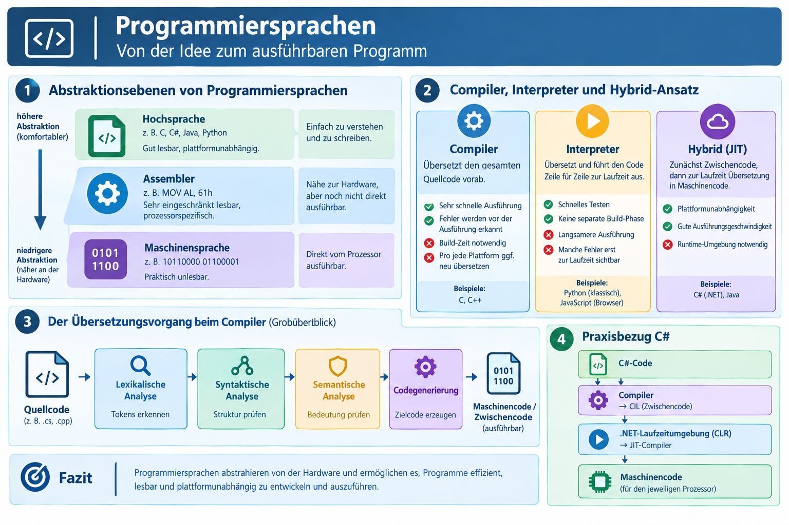
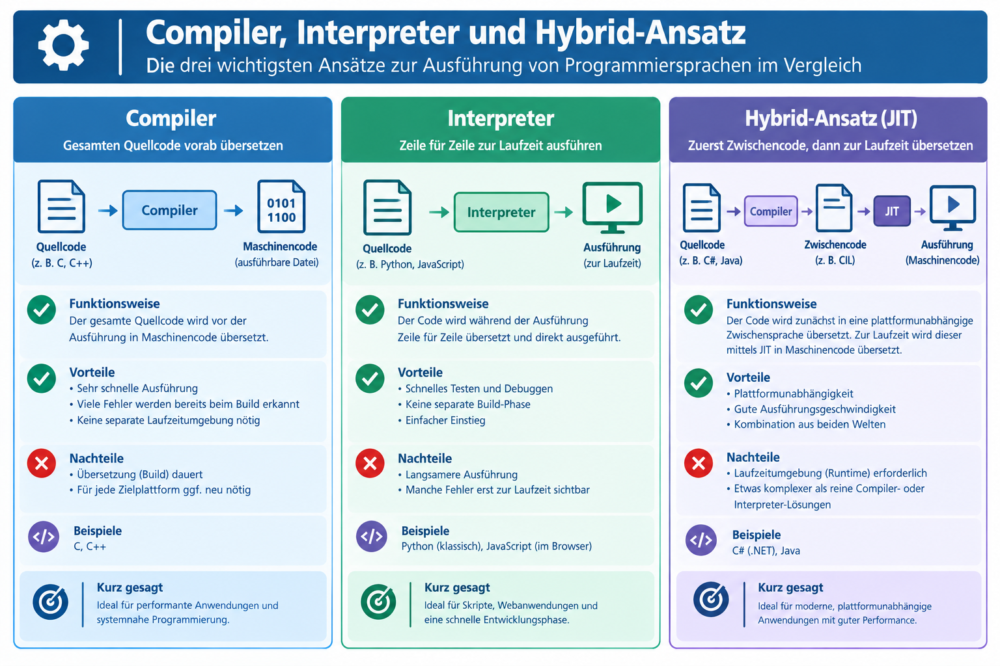
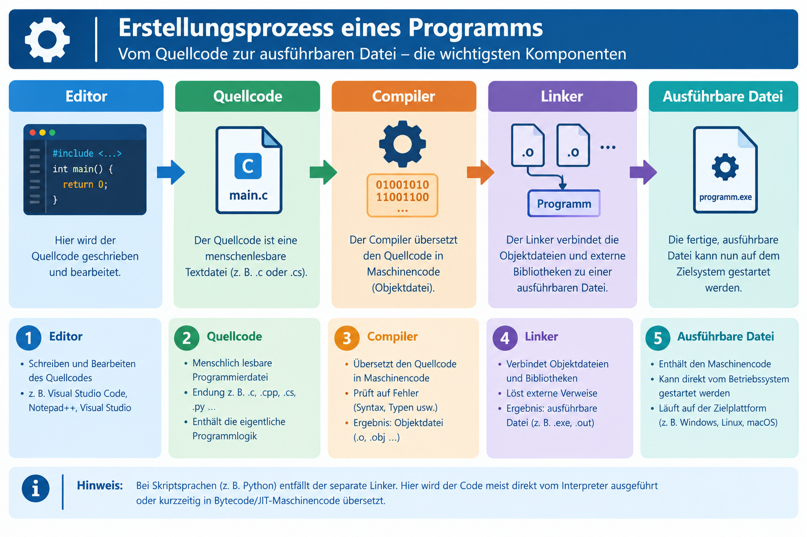

|                      |                           |                               |
| -------------------- | ------------------------- | ----------------------------- |
| **HF Systemtechnik** | **Softwareentwicklung A** |  |

- [1. Programmiersprachen](#1-programmiersprachen)
  - [1.1. Lernziele](#11-lernziele)
  - [1.2. Abstraktionsebenen von Programmiersprachen](#12-abstraktionsebenen-von-programmiersprachen)
  - [1.3. Compiler, Interpreter und Hybrid-Ansatz](#13-compiler-interpreter-und-hybrid-ansatz)
  - [1.4. Der Übersetzungsvorgang beim Compiler (Grobüberblick)](#14-der-übersetzungsvorgang-beim-compiler-grobüberblick)
  - [1.5. Kriterien zur Auswahl einer Programmiersprache](#15-kriterien-zur-auswahl-einer-programmiersprache)
  - [1.6. Praxisbezug: C und C# im Vergleich](#16-praxisbezug-c-und-c-im-vergleich)
- [2. Übungsaufgaben](#2-übungsaufgaben)
  - [2.1. Gruppenarbeit Skriptsprachen vs. Hochsprachen](#21-gruppenarbeit-skriptsprachen-vs-hochsprachen)
  - [2.2. Sprachwahl begründen](#22-sprachwahl-begründen)
  - [2.3. Begriffe zuordnen](#23-begriffe-zuordnen)

---

</br>

# 1. Programmiersprachen

## 1.1. Lernziele

Nach diesem Kapitel können Sie:

- [ ] die Abstraktionsebenen Maschinensprache, Assembler und Hochsprache unterscheiden
- [ ] die Aufgabe eines Compilers, Interpreters und Hybrid-Ansatzes (JIT) erklären
- [ ] den prinzipiellen Ablauf einer Übersetzung (Compilierung) grob beschreiben
- [ ] Kriterien zur Auswahl einer Programmiersprache für eine gegebene Aufgabenstellung anwenden
- [ ] C und C# hinsichtlich ihres typischen Einsatzgebiets einordnen

---

## 1.2. Abstraktionsebenen von Programmiersprachen



| **Ebene**            | **Beispiel**        | **Lesbarkeit für Menschen**                    | **Direkt vom Prozessor ausführbar?** |
| -------------------- | ------------------- | ---------------------------------------------- | ------------------------------------ |
| **Maschinensprache** | `10110000 01100001` | Praktisch unlesbar                             | Ja, direkt                           |
| **Assembler**        | `MOV AL, 61h`       | Sehr eingeschränkt lesbar, prozessorspezifisch | Nein, muss assembliert werden        |
| **Hochsprache**      | `x = 97;`           | Gut lesbar, plattformunabhängiger formuliert   | Nein, muss übersetzt werden          |

Jede höhere Ebene abstrahiert von den Details der darunterliegenden Ebene. Ein Befehl in einer Hochsprache wie C# entspricht oft Dutzenden bis Hunderten Maschinenbefehlen.

> **Warum diese Abstraktion sinnvoll ist:** Ohne Hochsprachen müsste jedes Programm für jeden Prozessortyp einzeln und in für Menschen kaum handhabbarer Form neu geschrieben werden. Hochsprachen ermöglichen Lesbarkeit, Wartbarkeit und – mit Einschränkungen – Portabilität zwischen unterschiedlichen Plattformen.

---

## 1.3. Compiler, Interpreter und Hybrid-Ansatz

Damit ein in einer Hochsprache geschriebenes Programm überhaupt ausgeführt werden kann, muss es in Maschinencode übersetzt werden. Dafür gibt es drei grundlegende Ansätze:

| **Ansatz**                    | **Prinzip**                                                                                                                                                   | **Vorteil**                                                             | **Nachteil**                                                      | **Beispiele**                               |
| ----------------------------- | ------------------------------------------------------------------------------------------------------------------------------------------------------------- | ----------------------------------------------------------------------- | ----------------------------------------------------------------- | ------------------------------------------- |
| **Compiler**                  | Übersetzt den **gesamten** Quellcode vorab vollständig in Maschinencode (eine ausführbare Datei)                                                              | Sehr schnelle Ausführung, Fehler werden vor der Ausführung erkannt      | Übersetzung (Build) dauert, für jede Zielplattform ggf. neu nötig | C, C++                                      |
| **Interpreter**               | Übersetzt und führt den Code **Zeile für Zeile zur Laufzeit** aus                                                                                             | Schnelles Testen, keine separate Build-Phase                            | Langsamere Ausführung, manche Fehler erst zur Laufzeit sichtbar   | Python (klassisch), JavaScript (im Browser) |
| **Hybrid (Zwischencode/JIT)** | Übersetzt zunächst in eine plattformunabhängige Zwischensprache; diese wird zur Laufzeit von einer Laufzeitumgebung in Maschinencode übersetzt (Just-in-Time) | Kombiniert Plattformunabhängigkeit mit guter Ausführungsgeschwindigkeit | Laufzeitumgebung (Runtime) muss auf dem Zielsystem vorhanden sein | C# (.NET), Java                             |



> **Praxisbezug C#:** Ein C#-Programm wird vom Compiler zunächst in die Zwischensprache **CIL** (Common Intermediate Language) übersetzt. Erst beim Start des Programms übersetzt die .NET-Laufzeitumgebung (CLR) diesen Zwischencode mittels JIT-Compiler in den für den jeweiligen Prozessor passenden Maschinencode.

## 1.4. Der Übersetzungsvorgang beim Compiler (Grobüberblick)

Ein Compiler durchläuft – vereinfacht dargestellt – folgende Schritte:

```bash
Quellcode → [Lexikalische Analyse] → [Syntaktische Analyse] → [Semantische Analyse] → [Codegenerierung] → Maschinencode/Zwischencode
```

| **Schritt**          | **Aufgabe**                                                                                 |
| -------------------- | ------------------------------------------------------------------------------------------- |
| Lexikalische Analyse | Zerlegt den Text in einzelne "Wörter" (Tokens): Schlüsselwörter, Variablennamen, Operatoren |
| Syntaktische Analyse | Prüft, ob die Token-Folge der Grammatik der Sprache entspricht (z. B. fehlendes Semikolon)  |
| Semantische Analyse  | Prüft inhaltliche Korrektheit (z. B. Datentyp-Kompatibilität, deklarierte Variablen)        |
| Codegenerierung      | Erzeugt den eigentlichen Maschinen- bzw. Zwischencode                                       |



---

## 1.5. Kriterien zur Auswahl einer Programmiersprache

In der Praxis ist die Wahl der Programmiersprache selten "die eine richtige Antwort", sondern eine Abwägung mehrerer Kriterien:

| **Kriterium**                 | **Fragestellung**                                                           |
| ----------------------------- | --------------------------------------------------------------------------- |
| **Einsatzgebiet**             | Embedded/Hardware-nah? Geschäftsanwendung? Web? Datenanalyse?               |
| **Performance-Anforderungen** | Muss der Code extrem schnell/ressourcenschonend laufen?                     |
| **Ökosystem/Bibliotheken**    | Existieren fertige Bausteine für die Aufgabe (z. B. Datenbankzugriff, GUI)? |
| **Plattform**                 | Muss der Code auf verschiedenen Betriebssystemen laufen?                    |
| **Team-Kenntnisse**           | Welche Sprache beherrscht das Team bereits?                                 |
| **Wartbarkeit langfristig**   | Wie gut ist die Sprache für spätere Anpassungen durch Dritte geeignet?      |

---

## 1.6. Praxisbezug: C und C# im Vergleich

|                    | **C**                                                                         | **C#**                                                                           |
| ------------------ | ----------------------------------------------------------------------------- | -------------------------------------------------------------------------------- |
| Typischer Einsatz  | Embedded Systems, Mikrocontroller (z.B. Arduino), hardwarenahe Programmierung | Geschäftsanwendungen, Desktop-/Web-Anwendungen, Schnittstellen (z. B. REST-APIs) |
| Übersetzung        | Compiler (direkt zu Maschinencode)                                            | Hybrid (Compiler zu CIL, dann JIT zur Laufzeit)                                  |
| Speicherverwaltung | Manuell (durch den/die Programmierer/-in)                                     | Automatisch (Garbage Collector)                                                  |
| Typische Stärke    | Sehr geringer Ressourcenverbrauch, direkter Hardwarezugriff                   | Produktive Entwicklung, umfangreiches Ökosystem (.NET)                           |

---

</br>

# 2. Übungsaufgaben

## 2.1. Gruppenarbeit Skriptsprachen vs. Hochsprachen

| **Vorgabe**         | **Beschreibung**                                                                                           |
| :------------------ | :--------------------------------------------------------------------------------------------------------- |
| **Lernziele**       | Die Studierenden sind in der Lage die Vor- und Nachteile von Skript- und Hochsprachen erläutern zu können. |
| **Sozialform**      | Gruppenarbeit                                                                                              |
| **Auftrag**         | siehe unten                                                                                                |
| **Zeitbedarf**      | 30 min Arbeit, 5-10 min Präsentation                                                                       |
| **Lösungselemente** | PowerPoint oder Markdown.                                                                                  |

**Aufgabenstellung:**

Ermitteln Sie alle wichtigen Informationen und Merkmale wodurch sich Skript- von Hochsprachen (wie C#, C++, Java etc.) unterscheiden. 
Unterlegen Sie Ihre Punkte mittels praxisorientierten Beispielen und Anwendungen. 
Die nachfolgenden Punkte geben Ihnen einen Rahmen vor:

- Einsatzbereich
- Performance
- Erstellungsprozess (Build)
- Lernkurve
- Typisierung
- IDE (Integrated Development Equipment), Tools
- Compiler / Interpreter

Stellen Sie Ihre Ergebnisse mittels einer Kurzpräsentation der Klasse vor. Verwenden Sie dabei die Hilfsmittel wie Flow-Charts, Video Beamer, Wandtafel usw. und verweisen Sie ggf. auf weitere die Literatur. Die Zusammenfassungen sind dann den anderen Klassenkameraden zur Verfügung zu stellen.

---

## 2.2. Sprachwahl begründen

| **Vorgabe**         | **Beschreibung**                                                         |
| :------------------ | :----------------------------------------------------------------------- |
| **Lernziele**       | Auswahlkriterien für Programmiersprachen auf konkrete Szenarien anwenden |
| **Sozialform**      | Partnerarbeit                                                            |
| **Auftrag**         | siehe unten                                                              |
| **Zeitbedarf**      | 20 min                                                                   |
| **Lösungselemente** | 3 begründete Sprachentscheidungen                                        |

**Aufgabenstellung:**

Begründen Sie für folgende drei Szenarien jeweils, welchen der drei Übersetzungsansätze (Compiler, Interpreter, Hybrid) bzw. welche Sprachkategorie Sie wählen würden:

1. Ein batteriebetriebener Temperatursensor mit sehr geringem Stromverbrauch, der Messwerte über viele Monate autonom aufzeichnet.
2. Eine unternehmensinterne Web-Anwendung zur Verwaltung von Serviceaufträgen, die von mehreren Entwicklern über Jahre weiterentwickelt wird.
3. Ein einmaliges Skript zum schnellen Testen einer Datenauswertung, das nur kurz zum Einsatz kommt.

---

## 2.3. Begriffe zuordnen

| **Vorgabe**    | **Beschreibung** |
| :------------- | :--------------- |
| **Sozialform** | Einzelarbeit     |
| **Zeitbedarf** | 15 min           |

**Aufgabenstellung:**

Ordnen Sie die folgenden Begriffe den drei Phasen aus obigen Kapitel "Der Übersetzungsvorgang beim Compiler" zu:

- `fehlendes Semikolon`
- `Variable ohne Deklaration verwendet`
- `Zerlegung in Schlüsselwörter`
- `Erzeugung der ausführbaren Datei`.
